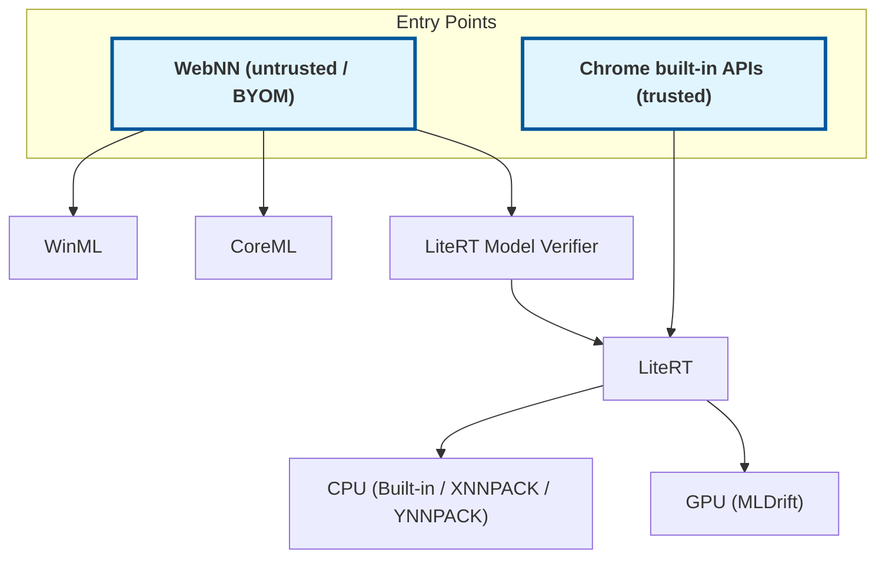
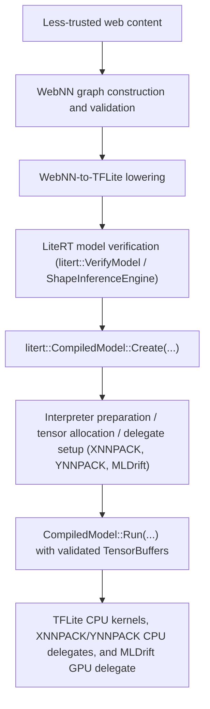

# LiteRT Runtime Threat Model and Fuzzing Policy

LiteRT uses the same security model as
[TensorFlow](https://github.com/tensorflow/tensorflow/security/policy), except
for code paths reachable from untrusted model sources such as WebNN in web
browsers. Under the default security model, TensorFlow and LiteRT (formerly
TensorFlow Lite) models are treated as programs: if you need to run untrusted
models, execute them inside a sandbox. This document defines the stricter threat
model for untrusted-model usage scenarios—with special focus on WebNN—and
specifies the verification, runtime, kernel, and fuzzing requirements that
complement browser sandboxing.

[WebNN](https://www.w3.org/TR/webnn/) is a proposed web standard designed to
accelerate deep neural networks and machine learning inference using a device's
native hardware directly inside the browser. A WebNN graph can be constructed
from JavaScript using untrusted web input, and the browser lowers that graph
into a backend format (such as a `.tflite` FlatBuffer). Even after browser-side
validation, a lowered model or dynamic runtime input could trigger memory
corruption, crashes, or hangs if runtime boundaries are not well defined.

The primary goal of this document is to clarify security responsibilities across
layers (model generation/lowering, the LiteRT model verifier, runtime/delegates,
and operator kernels) and to provide a consistent standard for triaging security
bugs. Although WebNN is the main motivating integration, the architecture is
intended to apply to any bring-your-own-model (BYOM) scenario loading untrusted
models.

The structure follows the threat-modeling workflow described in
[GitHub: What is threat modeling?](https://github.com/resources/articles/what-is-threat-modeling):
model the system, analyze threats, prioritize mitigations, and verify that
mitigations work.

## What are we working on?

### Scope

This threat model applies to LiteRT CPU and MLDrift (GPU) runtime code reachable
from WebNN through LiteRT's
[CompiledModel API](https://ai.google.dev/edge/litert/next/cpp). WebNN builds a
TFLite FlatBuffer for the requested graph, validates it with the LiteRT model
verifier (`litert::VerifyModel(...)` / `litert::Verify(...)`), and passes the
immutable buffer to `litert::CompiledModel::Create(...)`. Once a model passes
mandatory ingress validation, it should not cause crashes or undefined behavior
during compilation or execution.

The WebNN graph builder defines the reachable operator, data type, layout, and
execution surface. For this path, in-scope code includes:

*   `litert::CompiledModel::Create(const litert::Environment&,
    BufferRef<uint8_t>, Options&)` in `litert/cc/litert_compiled_model.h`, and
    the underlying runtime loading and compilation paths
    (`CreateModelFromBuffer`, `CreateCompiledModel`);
*   LiteRT model verification through `litert::VerifyModel(...)`,
    `litert::Verify(...)`, and `litert::LiteRtVerifier` in
    `litert/core/model/verifier.h` and `litert/core/model/verifier.cc`, together
    with `ShapeInferenceEngine` (`litert/core/model/shape_inference.h`) and
    per-op inferrers (`litert/core/model/ops/`);
*   TFLite interpreter, subgraph, tensor allocation, and tensor resizing code
    reachable while preparing or invoking WebNN-supported operators;
*   WebNN-reachable TFLite built-in operator kernels in `tflite/kernels/` and
    shared kernel helpers in `tflite/kernels/internal/`;
*   CPU execution implementations for WebNN-supported built-in operators,
    including reference kernels, optimized kernels, the
    [XNNPACK](https://github.com/google/XNNPACK) CPU delegate, and the YNNPACK
    CPU delegate (`tflite/delegates/ynnpack/`);
*   GPU execution through the **MLDrift** delegate (`ml_drift_delegate/`).

Each TFLite operator kernel exposes `Prepare()` and `Eval()` as its main entry
points. Security risks typically arise there during shape inference, tensor and
scratch allocation size calculations, index and stride arithmetic, quantization
parameter handling, or threadpool sharding. A built-in CPU operator may have up
to four execution paths:

1.  Reference kernels (simple baseline implementations);
2.  Generic and multithreaded optimized kernels;
3.  XNNPACK delegate kernels (device-specific, often using hand-tuned SIMD or
    assembly);
4.  YNNPACK delegate kernels (separate CPU delegate in the XNNPACK repository).

Any application that loads models from an untrusted source should invoke the
LiteRT model verifier (`litert::VerifyModel(...)` or `litert::Verify(...)`)
before loading, or enforce equivalent checks at ingress. Note that
`CompiledModel::Create(...)` does not run `litert::VerifyModel(...)`
automatically (and minimal builds compiled with
`LITERT_SKIP_FLATBUFFER_VERIFICATION` skip even FlatBuffer schema verification).

### System model and data flow

In this architecture, Chrome built-in APIs execute trusted, browser-managed
models and therefore do not pass through the untrusted-model verifier, whereas
WebNN and other bring-your-own-model (BYOM) paths must pass through
`LiteRT Model Verifier` before compilation.

The untrusted-model data flow is:

Security checks are layered by where an invariant can be established:

*   **WebNN / integration layer**: Enforces WebNN-specific limits, lowers the
    graph into an immutable TFLite FlatBuffer, runs mandatory ingress
    verification, and validates runtime tensor bindings before dispatch.
*   **LiteRT model verifier (`litert::VerifyModel` / `litert::Verify`)**:
    Enforces backend-independent structural, tensor, quantization, sparsity,
    buffer-bounds, and static per-op shape/type invariants once at model ingress
    rather than duplicating them across every delegate and kernel.
*   **Runtime, delegates, and operator kernels**: Validate dynamic shapes,
    runtime parameter tensor values, derived workspace/scratch allocation sizes,
    and backend-specific limits that static graph verification cannot prove.

Even with all verification and runtime checks in place, Chrome and other
Chromium-based browsers must still execute LiteRT inside a sandboxed process
acting on behalf of the web rather than the user.

### Threat agents and entry points

The primary threat agent is malicious or buggy web content that influences a
WebNN graph and the tensors supplied to it—including operator choices, operand
shapes, ranks, axis and parameter tensors, constants, external weights,
quantization metadata, and runtime input contents whenever they can affect
shape, allocation, indexing, offsets, loop bounds, or control flow.

The main entry points are:

*   WebNN graph validation and lowering into a TFLite FlatBuffer;
*   LiteRT model verification (`litert::VerifyModel(...)` /
    `litert::Verify(...)`) and model loading;
*   LiteRT `CompiledModel` creation, delegate partitioning, and interpreter
    preparation;
*   Tensor binding before `CompiledModel::Run(...)`;
*   Execution through TFLite CPU reference/optimized kernels, XNNPACK/YNNPACK
    CPU delegates, and the MLDrift GPU delegate.

This threat model does not assume arbitrary malicious native application code; a
native host that directly violates documented LiteRT or TFLite API contracts is
outside this boundary.

### In-scope operators

The in-scope WebNN-reachable TFLite built-in operators are:

`ABS`, `ADD`, `CAST`, `CEIL`, `COS`, `DEQUANTIZE`, `DIV`, `ELU`, `EQUAL`, `EXP`,
`FLOOR`, `GELU`, `GREATER`, `GREATER_EQUAL`, `HARD_SWISH`, `LEAKY_RELU`, `LESS`,
`LESS_EQUAL`, `LOG`, `LOGICAL_AND`, `LOGICAL_NOT`, `LOGICAL_OR`, `LOGISTIC`,
`MAXIMUM`, `MINIMUM`, `MUL`, `NEG`, `NOT_EQUAL`, `POW`, `PRELU`, `QUANTIZE`,
`RELU`, `RELU6`, `RELU_0_TO_1`, `RELU_N1_TO_1`, `ROUND`, `SELECT_V2`, `SIGN`,
`SIN`, `SQRT`, `SQUARE`, `SUB`, `TANH`, `ARG_MAX`, `ARG_MIN`, `AVERAGE_POOL_2D`,
`BATCH_MATMUL`, `BROADCAST_TO`, `CONCATENATION`, `CONV_2D`, `CUMSUM`,
`DEPTHWISE_CONV_2D`, `FULLY_CONNECTED`, `GATHER`, `GATHER_ND`, `MAX_POOL_2D`,
`MEAN`, `MIRROR_PAD`, `PAD`, `PADV2`, `REDUCE_MAX`, `REDUCE_MIN`, `REDUCE_PROD`,
`RESHAPE`, `RESIZE_BILINEAR`, `RESIZE_NEAREST_NEIGHBOR`, `REVERSE_V2`,
`SCATTER_ND`, `SLICE`, `SOFTMAX`, `SPLIT_V`, `SQUEEZE`, `STRIDED_SLICE`, `SUM`,
`TILE`, `TRANSPOSE`, `TRANSPOSE_CONV`

We intentionally keep this list concrete and bounded because kernel patches can
introduce unexpected breaking changes for existing applications. We avoid
non-essential security patches on operators outside this list unless a concrete
untrusted-model use case arises (though fuzzers for other operators may still
exist in `litert/test/fuzzing/` to improve general runtime robustness without
expanding this threat model).

### Model-generation and ingress invariants

Every TFLite model consumed by the runtime is produced by some tool or library.
In trusted-model deployments, that generator is part of the trusted computing
base. In untrusted-model deployments, the integration must run an explicit
ingress validation step immediately before `litert::CompiledModel::Create(...)`
and keep the model buffer and external data immutable for the entire lifetime in
which the verification result is relied upon. If a delegate (such as XNNPACK,
YNNPACK, or MLDrift) performs graph transformations during compilation or
loading, that delegate is responsible for ensuring its transformations preserve
safety given a valid input graph.

#### What `litert::VerifyModel` validates

LiteRT model verification is implemented as a self-contained verifier in
`litert/core/model/verifier.h` and `litert/core/model/verifier.cc` (it no longer
delegates to `tflite::Verify(...)`):

*   `absl::Status litert::VerifyModel(const void* buf, size_t len, const
    VerifyOptions& options = {})` (primary status-returning entry point);
*   `bool litert::Verify(const void* buf, size_t len, const VerifyOptions&
    options = {})` (boolean convenience wrapper);
*   `litert::LiteRtVerifier` (`tflite::TfLiteVerifier` adapter whose
    `Verify(const char* data, int length, tflite::ErrorReporter* reporter)`
    bridges to `tflite::FlatBufferModel::VerifyAndBuildFromBuffer`).

Note that `litert/core/model/verifier.h` is currently an internal LiteRT core
header rather than part of the public C/C++ SDK headers under `litert/c/` or
`litert/cc/`.

Given a serialized model buffer and its full allocation length `len`,
`litert::VerifyModel(...)` enforces:

*   **FlatBuffer and schema integrity**: FlatBuffer table/vector bounds
    (`tflite::VerifyModelBuffer`) and `TFLITE_SCHEMA_VERSION` match.
*   **Subgraph and operator consistency**: Non-null subgraphs, tensors,
    operators, and opcodes; valid `opcode_index` and `BuiltinOperator` enum
    bounds (`ValidateFlatBufferOperatorCodes`); all non-optional operator inputs
    are produced by constants, variables, subgraph inputs, or preceding ops; no
    cycles and no writes to constant, variable, or subgraph-input tensors.
*   **Appended out-of-FlatBuffer payload bounds**: Overflow-safe range checks
    ensuring every `Buffer.offset`/`Buffer.size` and
    `Operator.large_custom_options_offset`/`large_custom_options_size` pair lies
    completely within `[0, len]`.
*   **Constant buffer validation**: String tensor header/offset-table integrity
    and exact numeric/sparse constant byte-size checks.
*   **Tensor rank, dimension, and `int32_t` flat-size bounds**: Known rank when
    `VerifyOptions::require_all_tensor_shape_ranks_known = true` (default),
    configurable `VerifyOptions::max_rank` capped at `LITERT_TENSOR_MAX_RANK`
    (currently `8`), dimensions `>= -1`, matching `shape_signature` rank, and
    `int32_t` overflow checks on the product of all positive (`> 1`) dimensions
    across `shape`, `shape_signature`, and unpacked LiteRT tensors (even when
    another dimension is `0` or `-1`).
*   **Quantization and sparsity metadata**: Affine per-axis scale/zero-point
    length and `quantized_dimension` bounds; `BlockwiseQuantization` and
    `MultiAxisQuantization` scales/zero-points tensor indices, static parameter
    tensor shapes, `block_shape`, and `block_size` divisibility for `INT4`,
    `UINT4`, and `INT2`; rejection of unsupported `CustomQuantization`; and
    level-by-level `SparsityParameters` validation (`traversal_order`,
    `dim_metadata`, `block_map`, segment/index ranges) even when `buffer == 0`.
*   **Static per-op shape and parameter validation**: Unpacking into LiteRT IR
    and running `ShapeInferenceEngine` across all subgraphs when
    `VerifyOptions::run_shape_inference = true` (default), including recursive
    `SHLO_COMPOSITE` decomposition inference with cycle detection. Examples
    include checking that grouped `CONV_2D` channels divide cleanly by groups,
    that `RESHAPE` has at most one `-1` dimension, and that `SLICE` `begin` and
    `size` index tensors have matching types and valid bounds.

#### Configurable rank limits across layers

Tensor rank limits operate at three distinct layers:

1.  **LiteRT IR ceiling**: `LITERT_TENSOR_MAX_RANK` (currently `8`, defined in
    `litert/c/litert_layout.h`) is the hard maximum rank supported by LiteRT's
    verifier and runtime layout types.
2.  **Backend-specific limits**: Individual backends may impose tighter limits
    (for example, MLDrift GPU supports tensor ranks up to `5`).
3.  **Application-configured ingress limit**: Callers can set
    `VerifyOptions::max_rank` to any value `<= LITERT_TENSOR_MAX_RANK` (for
    example, `6` or `5`) to enforce their application's or target backend's rank
    cap at verification time.

#### Current verifier limitations

Untrusted-model integrations and fuzzers should account for invariants that
`litert::VerifyModel(...)` does **not** yet fully cover:

*   **Externalized weight metadata (`Tensor.external_buffer`)**: `verifier.cc`
    treats `tensor.external_buffer() > 0` as a constant tensor during graph
    consistency checks, but does not yet validate `Model.external_buffers` /
    `Model.external_buffer_groups` IDs, offsets, or byte lengths. Integrations
    using separate external weight files must validate those descriptors at
    ingress.
*   **Incomplete shape-inferrer coverage for
    `require_supported_op_shape_inferrers`**:
    `VerifyOptions::require_supported_op_shape_inferrers` defaults to `false`.
    Enabling it prevents ops without a registered inferrer from silently
    downgrading downstream tensors to dynamic (`-1`) shapes. However, two
    operators in the current WebNN in-scope list—`SCATTER_ND` and `SPLIT_V`—do
    not yet have registered inferrers in `ShapeInferenceEngine`. Until those
    inferrers are added, callers must validate those ops in lowering (or add
    inferrers before enabling `require_supported_op_shape_inferrers = true`).
*   **Partial per-op type and output-shape validation**: `VerifyModel` invokes
    `InferOpShapes(op, /*validation_only=*/false)` and not all per-op inferrers
    check every element-type constraint from TFLite's MLIR op definitions
    (`tensorflow/compiler/mlir/lite/ir/tfl_ops.td`). For example, `InferCumsum`
    does not yet reject a `CUMSUM` node whose input is `TensorType_INT64` and
    output is `TensorType_INT8`. Constraints not yet enforced by
    `ShapeInferenceEngine` should be validated during lowering or added to the
    verifier's per-op inferrers.

#### Division of responsibility

If a static, backend-independent sanitization check can be performed in the
LiteRT model verifier (including `ShapeInferenceEngine`), put it there rather
than duplicating it in each delegate or op kernel. Code consuming a verified,
immutable model may rely on static invariants established by the verifier and
only needs to enforce dynamic shapes, runtime parameter tensor values, derived
workspace/allocation sizes, and backend-specific limits. APIs that construct an
interpreter or `CompiledModel` from an unverified model are outside the
untrusted-model security boundary unless the caller performs equivalent ingress
validation first.

Fuzzers should distinguish between bugs still reachable after required ingress
checks pass and bugs that are already blocked by `litert::VerifyModel(...)` or
documented WebNN lowering invariants.

### WebNN build and dispatch invariants

WebNN graph construction is a data-definition phase and should not execute the
graph. The runtime attack surface begins when the graph is compiled into a
TFLite model and when tensors are bound for execution.

During WebNN build and lowering, before passing a FlatBuffer to
`litert::CompiledModel::Create(...)`, the integration must establish:

*   WebNN operator data type, rank, shape, broadcast, layout, and option
    constraints;
*   implementation limits for ranks, element counts, tensor byte lengths, and
    tensor counts (Chromium's WebNN TFLite integration currently caps untrusted
    tensors at rank `8`, with stricter per-op limits where required);
*   per-operator zero-dimension constraints (rejecting unsupported empty
    operands, such as an empty `CONV_2D` filter tensor, before loading or
    execution);
*   valid constant buffers, external weight descriptors, quantization metadata,
    and helper operators emitted by lowering;
*   immutability and lifetime guarantees for constant data for the full lifetime
    of the compiled graph (constants must be copied, transferred, or
    snapshotted);
*   ingress validation at least as strong as `litert::VerifyModel(...)` (or an
    explicit `litert::VerifyModel(...)` / `litert::Verify(...)` call before
    loading).

During WebNN dispatch, before calling `CompiledModel::Run(...)`, the integration
must validate tensor bindings against the build-time graph descriptors:

*   the graph belongs to the dispatch context and has not been destroyed;
*   every required input and output name is present, and no unexpected binding
    is supplied;
*   all bound tensors belong to the same WebNN context as the graph and have not
    been destroyed;
*   the same tensor is not bound more than once across inputs and outputs;
*   constant tensors are not used as dispatch inputs or outputs;
*   each bound tensor's data type, shape, and buffer byte length exactly match
    the corresponding graph descriptor;
*   LiteRT `TensorBuffer` objects are created only from validated descriptors
    and validated storage.

The LiteRT CPU runtime, XNNPACK/YNNPACK CPU delegates, and MLDrift GPU delegate
remain accountable for validating op-specific, derived, dynamic, and
execution-time invariants that cannot be established at ingress.

### Out of scope

This document does not cover:

*   general TFLite/LiteRT model loading outside untrusted/WebNN-reachable paths,
    where the default trusted-model assumption applies;
*   TFLite built-in operators, data types, layouts, or execution paths that
    WebNN cannot trigger;
*   other delegates: CoreML, Flex, the legacy TFLite GPU delegate, Hexagon,
    NPU/vendor delegates, and custom delegates;
*   custom operators;
*   malicious host application code that violates documented LiteRT or TFLite
    API contracts;
*   model converter, developer tools (such as benchmark tools and numeric
    debuggers), samples, and demos, except where runtime kernel behavior depends
    on converted metadata;
*   path traversal vulnerabilities (which should be mitigated by OS or process
    sandboxes such as chroot, containers, or SELinux);
*   model authenticity, signing, distribution policy, or vulnerability
    disclosure policy.

<!-- disableFinding(LINK_RELATIVE_G3DOC) -->

For the vulnerability reporting policy, see [SECURITY.md](../../SECURITY.md).

<!-- enableFinding(LINK_RELATIVE_G3DOC) -->

### Security boundary

LiteRT and TFLite run inside the host application process; the runtime is not a
sandbox. For untrusted/WebNN-reachable paths, the primary security boundary lies
between untrusted model/graph data (and WebNN-fed tensors) and the memory of the
process executing the LiteRT runtime.

Treat the following inputs as adversarial when they can originate from a WebNN
graph, lowered model, or WebNN-fed tensor:

*   FlatBuffer model metadata;
*   tensor ranks and dimensions;
*   axis tensors and other parameter tensors;
*   quantization parameters;
*   sparsity metadata;
*   dynamic tensor shapes;
*   runtime input tensor contents when they can affect indexing, shape,
    allocation, resizing, or control flow.

### Assets and security properties

Security reviews should preserve:

*   application process memory integrity and confidentiality;
*   control-flow integrity;
*   clean rejection of invalid or unsupported models (`kTfLiteError` /
    non-`kLiteRtStatusOk`) without crashes or `CHECK` aborts;
*   deterministic safety across supported 32-bit and 64-bit platforms;
*   reasonable availability for valid inputs within documented resource limits.

### Platform assumptions

LiteRT and TFLite must support both 32-bit and 64-bit environments; 32-bit
Android remains an important target. Kernel and runtime code must not assume
that:

*   `size_t` is wider than 32 bits;
*   a pointer-sized type can hold every shape product present in a model;
*   `int` can hold an element count, byte count, or flattened index without an
    explicit checked conversion;
*   high tensor rank is invalid merely because it is inconvenient for one
    helper.

Because TFLite/LiteRT can be delivered to applications through system updates
(including Google Play framework updates), maintaining backwards compatibility
for existing trusted apps is a top priority. Avoid adding broad defensive
assumptions (such as hardcoding a low rank cap like `rank <= 6`) inside existing
built-in TFLite op kernels unless required by an actual algorithm, storage, or
delegate constraint. Enforce stricter untrusted-model caps at higher layers such
as WebNN lowering or `VerifyOptions::max_rank`.

### Memory buffer alignment and arithmetic assumptions

#### Buffer alignment and padding

Alignment is a mandatory API and memory-safety invariant, not merely a
performance hint, because some targets trap on unaligned access and C/C++ treat
misaligned typed pointer dereferences as undefined behavior even on
architectures that tolerate unaligned loads. Runtime and kernel code must never
construct or dereference misaligned typed pointers.

For LiteRT host-memory tensors:

*   Host-memory `LiteRtTensorBuffer` objects must satisfy
    `LITERT_HOST_MEMORY_BUFFER_ALIGNMENT` (currently `64` bytes, defined in
    `litert/c/litert_tensor_buffer_types.h`). Contiguity and natural element
    alignment alone are insufficient.
*   Delegate-specific trailing padding requirements—such as `XNN_EXTRA_BYTES`
    (`16` bytes) for XNNPACK—are separate and must also be satisfied.
*   `CreateManagedOnHostMemory` allocates aligned storage with trailing
    `XNN_EXTRA_BYTES` padding. `CreateFromHostMemory` validates alignment and
    tensor byte size via `LiteRtTensorBufferT::IsValid()`, but does not
    automatically verify trailing `XNN_EXTRA_BYTES` padding or external lifetime
    and mutability; integrations wrapping external storage must ensure those
    requirements are satisfied before dispatch (or allocate through LiteRT
    managed-buffer APIs / copy into conforming storage).
*   Once a buffer has been accepted as conforming, downstream runtime and kernel
    code may rely on that base contract, while still validating any derived
    pointer or offset.

#### Signed integer overflow

Signed integer overflow falls into two distinct categories:

*   **Metadata and memory-access arithmetic (security-critical)**: Element
    counts, byte sizes, allocation sizes, shapes, offsets, strides, flattened
    indexes, loop bounds, shard ranges, and pointer arithmetic must not overflow
    unless already proven safe by a documented verifier or ingress invariant.
    Use checked or widened arithmetic whenever computing these from dynamic
    inputs, op parameters, shape tensors, or derived intermediate values.
*   **Tensor-value arithmetic (generally non-security)**: Overflow while
    computing ordinary tensor element values—such as integer `SUM` or `PROD`
    accumulation—is **not** a security issue under this threat model as long as
    the computed values cannot influence indexing, allocation, tensor resizing,
    loop bounds, or control flow. (By contrast, runtime tensor values that feed
    dynamic shape, padding, slice, or index operands of downstream ops *are*
    security-critical and must be validated by the consuming op.)

When an operator intentionally allows wrapping tensor-value arithmetic, make
that behavior explicit where practical or annotate the narrow kernel helper with
`TFLITE_NO_SANITIZE_INTEGER_OVERFLOW` (`tflite/core/macros.h`). Triage sanitizer
findings in pure tensor-value arithmetic as correctness or sanitizer noise
unless the value can affect memory access or control flow.

## What can go wrong?

### Background: how TFLite memory planning works

A TFLite model describes graph-visible tensors such as model inputs, constants,
intermediate results, and model outputs. Before executing a statically shaped
graph, `AllocateTensors()` calls each operator's `Prepare()` function in
execution order. `Prepare()` validates the operator, derives output shapes, and
resizes output tensors, converting element types and dimensions into required
byte counts.

An operator can also create temporary or scratch tensors that are not visible in
the model graph—for example, `im2col` workspaces in convolutions, packed weight
buffers, or hybrid quantization scratch buffers—either as temporary
`TfLiteTensor` objects attached to a node or via the runtime scratch-buffer API.

Once operators are prepared, the arena memory planner assigns storage based on
tensor lifetimes. Most writable inputs, outputs, intermediates, and temporary
tensors share the non-persistent arena; data surviving across invocations uses
the persistent arena; and read-only constants generally point directly into
model storage. Two non-overlapping tensors can reuse the same arena region.
Planning is separate from allocation: if an arena grows, its base address can
move and tensor pointers are re-resolved, so kernels must never retain stale
pointers across reallocations.

Dynamic tensors make this incremental. When an output shape cannot be known
during initial `Prepare()`, TFLite allocates the known prefix of the graph;
after an operator resizes a dynamic tensor during `Eval()`, the runtime
re-prepares affected downstream ops and updates the arena plan. Checks run only
during initial `Prepare()` therefore cannot protect values that become known at
invocation time.

The memory planner is not an operator verifier—it trusts tensor dimensions and
byte counts. Safe execution requires exact agreement among the shapes derived by
`Prepare()` or dynamic resizing, the byte count given to the planner, and the
strides, flattened indexes, and loop bounds used in `Eval()`.

### High-priority security threats

Treat the following as security-relevant unless proven otherwise:

*   unchecked integer overflow in element counts, byte counts, allocation sizes,
    flattened indexes, strides, offsets, or loop bounds that are dynamic,
    derived inside the runtime, or not already covered by ingress validation;
*   shape normalization overflow, including intermediate products for tensors
    with a zero dimension;
*   out-of-bounds reads or writes caused by inconsistent tensor metadata and
    backing buffers;
*   null data pointer dereference when the logical access count is nonzero;
*   use-after-free or stale tensor pointer use after arena reallocation;
*   inconsistent validation between `Prepare()` and `Eval()`;
*   inconsistent validation across reference, optimized, XNNPACK, YNNPACK, and
    MLDrift execution paths;
*   thread-sharding arithmetic that produces invalid ranges or skips bounds
    checks;
*   quantized multiplier, shift, zero-point, blockwise metadata, or accumulator
    math that affects memory access, indexing, or allocation.

### Common kernel implementation pitfalls

The categories below capture recurring patterns that make kernel code
memory-unsafe when untrusted data can reach them after required ingress checks.

#### Treat every derived shape as a new untrusted calculation

Validating graph-visible tensors does not validate shapes derived inside a
kernel. Output tensors, temporary workspaces (`im2col` in `CONV_2D`/`CONV_3D`,
`col2im` in `TRANSPOSE_CONV`), transposed/packed weights, per-channel scaling
buffers, row sums, and per-thread workspaces all introduce new sums and
products. For example, an `im2col` workspace has dimensions proportional to
`batch * out_height * out_width * filter_height * filter_width *
filter_input_channels`, which can vastly exceed both input and output sizes.

For every derived workspace, check the complete element-count expression, check
the conversion from elements to bytes separately, and check any narrower integer
range required by downstream helpers (such as `int32_t` flat indexes) before
registering the temporary tensor or allocating memory.

#### Validate relationships, not only individual tensors

Individually valid tensors can still form an invalid operation. Check the
equalities, divisibility rules, rank relationships, and type combinations loops
depend on before computing bounds or allocations:

*   `CONV_2D` / grouped convolution: compatible input, filter, bias, and output
    channels; non-zero channel counts before division/modulo; clean divisibility
    by group count.
*   `DEPTHWISE_CONV_2D`: integral `depth_multiplier` matching channel counts.
*   `TRANSPOSE_CONV`: requested `output_shape` consistent with input, filter,
    stride, and padding rather than merely non-negative.

Place shared invariants in shared validation helpers (or in
`ShapeInferenceEngine` when static) so execution paths cannot diverge.

#### Make integer domains, narrowing conversions, and sub-byte packing explicit

TFLite dimensions are typically signed `int`, tensor byte sizes use `size_t`,
many flattened-shape helpers return signed 32-bit `int`, and some optimized
paths store parameters such as strides or dilations in `int16_t`.

*   Promote operands *before* multiplying or adding, use checked arithmetic in
    the promoted type, and validate destination bounds before narrowing. Casting
    an already-overflowed value is too late.
*   On 64-bit hosts, a tensor with more than `INT32_MAX` elements can fit in
    64-bit `size_t` allocation (`BytesRequired`) yet overflow signed 32-bit
    `int` in `RuntimeShape::FlatSize()`, `Offset(...)`, or `im2col` helpers.
    Check that element counts fit `int` whenever downstream helpers index with
    `int`.
*   Check intermediate stride/dilation formulas such as
    `(filter_size - 1) * dilation + 1`, which can overflow even if the final
    output dimension looks small.
*   **Sub-byte packed types (`INT4`, `UINT4`, `INT2`)**: Never compute
    `(element_count + 1) / 2` or `(element_count + 3) / 4` directly in `size_t`
    because adding `1` or `3` near `SIZE_MAX` (e.g., on 32-bit targets) wraps to
    `0` and allocates a 0-byte buffer. Use overflow-free ceiling division:
    `count / per_byte + (count % per_byte != 0 ? 1 : 0)`. Avoid left-shifting
    negative signed integers when unpacking sub-byte values.

#### Keep allocation and access calculations consistent

The calculation used to allocate a tensor and the calculation used to access it
form one safety invariant. If `Prepare()` computes byte size with one width or
order while `Eval()` computes flat indexes or copy sizes differently (for
example, in `PAD` where output dimensions add input size plus before/after
paddings), a wrapped allocation size can leave less arena memory than `Eval()`
writes. Prefer a shared checked calculation consumed by both allocation and
execution.

#### Validate values in the phase where they become available

`Prepare()` can validate options, constant parameter tensors, and static shapes,
but cannot validate dynamic parameter tensors whose contents arrive at
invocation time (such as dynamic `PAD` paddings, dynamic `RESHAPE` targets, or
dynamic `SLICE`/`GATHER` indices). Run validation after inputs are known and
before the first allocation, resize, index calculation, or pointer access—and
always re-fetch tensor pointers and shapes after any dynamic resize.

#### Bounds-check offsets, strides, indexes, and work ranges

A valid total allocation size does not guarantee every derived offset stays in
bounds. Use checked arithmetic and explicit bounds checks for row strides, flat
indexes, copy ranges, reflection offsets, and thread-sharding partitions:

*   `MIRROR_PAD`: padding on either side must not exceed `input_size - 1` in
    `REFLECT` mode or `input_size` in `SYMMETRIC` mode, or reflected indexes
    escape the input buffer.
*   Cropping/strided padding (such as StableHLO pad with negative edge padding
    and interior padding): validate stride products, starting offsets, and the
    full copied range.
*   Thread partitioning: validate task counts, shard start/end bounds, and
    `shard_index * stride` before launching worker threads.

#### Zero-element tensors and null data pointers

Empty tensors (shapes where at least one dimension is `0`, yielding `0` total
elements) have different contracts across backends:

*   **Built-in CPU kernels and XNNPACK**: Permit empty tensor shapes when the
    operator contract allows them (for example, an empty initial past-KV tensor
    in `CONCATENATION` during batched prefill, or a zero-batch input in
    `CONV_2D` while still requiring a non-empty filter tensor and non-zero
    channel counts). Zero-byte arena allocations may resolve to `nullptr`, and
    the XNNPACK delegate binds a dummy non-null pointer (`&dummy_data_`) for
    zero-byte external values while skipping zero-element executions.
*   **MLDrift (GPU) and other hardware delegates**: May cleanly reject graphs
    with unsupported empty tensor shapes during partitioning, `Prepare()`, or
    `Invoke()`.

Across **all** backends:

*   A null data pointer is valid if and only if zero elements are accessed.
    Guard loops, `memcpy`, and `memset` when element count is zero
    (`memcpy(nullptr, nullptr, 0)` is undefined behavior in C/C++).
*   Handle operators where an empty input produces a non-empty output (such as
    `PAD` adding positive padding around an empty input): allocate and fill the
    output while skipping the input copy.
*   **Never let a `0` dimension short-circuit overflow or range checks on other
    dimensions.** A shape like `{65536, 65536, 0}` has zero total elements, yet
    an outer loop bound computing `65536 * 65536` before encountering the `0`
    still overflows `int32_t`. Validate every dimension and intermediate product
    independently of zero factors.

#### Keep all execution paths under one validation contract

Reference, generic optimized, multithreaded, quantized, XNNPACK, YNNPACK, and
MLDrift implementations can differ in scratch tensors, integer widths, layouts,
and indexing strategies. Place shared operator invariants before dispatch, add
path-specific checks where an implementation has a stricter real constraint, and
revalidate assumptions on any fallback path. A failed check, resize, or
temporary allocation must halt execution cleanly rather than leaving a partially
prepared state.

### Robustness and correctness issues

The following are usually **not** security vulnerabilities by themselves, though
they should be fixed or documented when practical:

*   numerical precision differences that do not affect memory safety (such as
    elementwise off-by-one differences between built-in CPU and XNNPACK
    quantized outputs);
*   NaN and infinity propagation differences within the operator contract;
*   integer tensor-value overflow (e.g., `SUM`, `PROD`) when wrapping or
    implementation-defined value behavior cannot affect indexing, allocation,
    resizing, loop bounds, or control flow;
*   invalid models rejected cleanly with an error status;
*   resource exhaustion from very large *valid* models within documented
    behavior. At the TFLite layer, this can be bounded with the pluggable
    `TfLiteAllocator` interface (`tflite::Interpreter::SetAllocator`, used by
    `FuzzerQuotaAllocator` in fuzz tests); exposing an equivalent quota
    allocator hook through LiteRT's `CompiledModel` API is an integration
    hardening opportunity for untrusted-model deployments;
*   multithreading races that cause lost updates without affecting memory
    safety.

## What are we going to do about it?

### Coding requirements

Hardening changes should follow these rules:

*   **Verifier first**: Implement backend-independent static checks in the
    LiteRT model verifier (`litert/core/model/verifier.cc` and
    `ShapeInferenceEngine` / `litert/core/model/ops/`) rather than duplicating
    them across delegates and op kernels. Add kernel/delegate checks for dynamic
    shapes, runtime parameter tensors, derived workspaces, backend-specific
    limits, or paths demonstrated by tests to bypass static verification.
*   **Use established checked-math helpers**:
    *   In `litert/core/model/`: use `SafeInt` (`SafeInt.hpp`) with non-throwing
        `.Ptr()`, `SafeMultiply`, and `SafeAdd` operations.
    *   In `tflite/`: prefer `CheckedNumElements` and `BytesRequired`
        (`tflite/util.h`), `CheckedInt<T>` (`tflite/checked_int.h`),
        `CheckedShapeProduct` / `CheckedShapeProductToInt` / `GetInputSafe` /
        `GetOutputSafe` (`tflite/kernels/kernel_util.h`), and
        `CheckedDimensionProduct` / `CheckedTensorElementsAndData` /
        `GetTensorElementCountAndValidateData` / `ReadAndNormalizeAxis`
        (`tflite/kernels/internal/kernel_utils.h`).
*   **Prefer signed integer types** for numeric quantities per the
    [Google C++ Style Guide](https://google.github.io/styleguide/cppguide.html):
    signed overflow is undefined behavior detectable by UBSan during fuzzing,
    whereas unsigned overflow wraps silently.
*   **Handle `size_t` vs. `int` explicitly**: Use `size_t` for element and byte
    counts that may exceed `int`, and perform checked narrowing at every API or
    helper boundary requiring `int` (or narrower types).
*   **Validate before consuming**: Check ranks, dimensions, axes, quantization
    parameters, derived workspace sizes, and non-null data pointers before any
    loop or memory access that depends on them.
*   **Keep zero-element handling explicit**: Support valid empty shapes on CPU
    and XNNPACK without dereferencing null pointers, and cleanly reject
    unsupported empty operands (and unsupported empty shapes on hardware
    delegates like MLDrift).
*   **Keep 32-bit behavior explicit**: Avoid disabling tests for 32-bit builds
    unless a specific assertion solely exercises the `INT32_MAX < n <= SIZE_MAX`
    gap on 64-bit hosts (guard only that assertion with
    `if constexpr (sizeof(size_t) >= 8)`).
*   **Maintain path parity**: Share validation helpers across reference,
    optimized, multithreaded, and delegated paths wherever contracts align.

### Unit test requirements

Every security or hardening bug found by review or fuzzing should get a fast,
deterministic unit test alongside the affected component (`tflite/kernels/`,
`tflite/kernels/internal/`, or `litert/core/model/`).

*   **Verify test efficacy (red-green check)**: Before landing a fix,
    temporarily revert the production change and confirm the new unit test
    actually fails (reproduces the missing check, crash, or sanitizer finding)
    rather than passing due to an unrelated earlier error. Assert specific error
    substrings where practical.
*   **Avoid multi-GiB real allocations**: To test `> INT32_MAX`-element shapes
    without OOMing, test helpers on shape-only `TfLiteTensor` objects or
    override `TfLiteContext::ResizeTensor` in kernel tests so metadata updates
    without allocating multi-GiB arena buffers.
*   **Cover critical boundaries**:
    *   WebNN-reachable rank boundaries (up to `LITERT_TENSOR_MAX_RANK == 8`,
        plus stricter per-op or backend limits such as MLDrift rank `5`);
        higher-rank direct TFLite tests remain useful robustness coverage;
    *   duplicate, negative, empty, dynamic, and unsorted axes;
    *   zero-element tensors, including huge-plus-zero shapes like
        `{65536, 65536, 0}`;
    *   32-bit overflow boundaries and sub-byte (`INT4`/`UINT4`/`INT2`) packing
        boundaries;
    *   reference, optimized, and multithreaded kernels where multiple exist;
    *   XNNPACK, YNNPACK, and MLDrift paths where in scope;
    *   both quantized and floating-point paths when supported.

### Fuzzing policy

Fuzz tests live in `litert/test/fuzzing/` and use the
[Google FuzzTest](https://github.com/google/fuzztest) framework. See
`litert/test/fuzzing/README.md` for full authoring and execution guidelines.

Key policy requirements:

*   **State the tested contract**: Explicitly declare whether a property covers
    model verification/loading (`model_fuzzer_test.cc`), built-in CPU reference
    or optimized kernels, or a delegate backend (XNNPACK, YNNPACK, MLDrift).
*   **Use property-based fuzzing with separated valid and malformed domains**:
    Per-op fuzzers use `BuildAndRunOneOpModel` with `litert::VerifyModel(...)`
    and `FuzzerQuotaAllocator` (`max_live_allocation_bytes`). Keep valid
    properties (`EXPECT_EQ(..., RunResult::kSuccess)`) separate from malformed
    properties (`EXPECT_EQ(..., RunResult::kRejected)`) so valid inputs reach
    deep execution paths while malformed properties test single-invariant
    boundaries cleanly. Never clamp a valid domain without a paired malformed
    property crossing that boundary.
*   **Cover all execution variants explicitly and observably**:
    *   Sweep built-in CPU variants (`Register_REF`, `Register_GENERIC_OPT`,
        `Register_MULTITHREADED_OPT`) via parameterized domains or clearly named
        properties in the built-in fuzz target.
    *   Keep delegate-enabled fuzzers as separate explicit build targets (for
        example, `pad_xnnpack_fuzz_test`, `convolution_xnnpack_fuzz_test`) and
        assert in the harness/smoke tests that delegation actually occurred
        rather than silently falling back to built-in kernels.
*   **Keep per-iteration tensors small**: Large tensors slow fuzzing by 100x or
    more. Bound tensor sizes and live allocations in end-to-end op fuzzers, and
    add separate focused `FUZZ_TEST`s on internal shape/byte helpers to fuzz
    `INT32_MAX` / `SIZE_MAX` arithmetic boundaries.
*   **Run in smoke mode in CI and with ASan/UBSan in campaigns**: CI runs all
    fuzz tests in short smoke mode on every change; when adding or modifying a
    fuzzer, run coverage-guided fuzzing locally with ASan and UBSan long enough
    to exercise the domain, and promote minimized reproducers to deterministic
    unit tests.
*   **General robustness fuzzing**: Fuzzers for operators outside the current
    WebNN list are welcome for general runtime robustness, but findings must be
    triaged against the WebNN reachability boundary defined in this document.

Treat the following fuzzer outcomes as bugs:

*   crashes, sanitizer findings, null dereferences, out-of-bounds accesses,
    use-after-free, or memory leaks reachable from model-controlled input;
*   undefined behavior in shape, indexing, allocation, or control-flow math;
*   valid properties returning `kRejected` or malformed properties returning
    `kSuccess`;
*   `kHarnessFailure` or a delegated target silently falling back without
    delegating;
*   divergent validation between execution paths that enables memory-unsafe
    execution.

### 32-bit coverage

Shape, index, packing, and allocation changes should be validated in a 32-bit
configuration. Developers can verify 32-bit behavior locally by using:

*   32-bit x86/ARM build and test runs or 32-bit Android emulator execution;
*   32-bit cross-build coverage for compile-time portability;
*   targeted unit tests that exercise 32-bit overflow boundaries even on 64-bit
    hosts.

Host-only 64-bit tests do not fully validate code paths where `size_t` or
pointer-sized arithmetic behaves differently on 32-bit targets.

## Did we do a good job?

Use this checklist before landing hardening changes:

*   Did the review identify every model-controlled or runtime field crossing the
    trust boundary?
*   Were static, backend-independent checks placed in `litert::VerifyModel` /
    `ShapeInferenceEngine` instead of duplicated across kernels and delegates?
*   Are all element count, byte count, sub-byte packing, shape product, offset,
    stride, and loop-bound calculations checked?
*   Are all narrowing conversions explicitly range-checked before casting?
*   Do zero-element tensors avoid data access while still validating all
    non-zero dimensions and metadata?
*   Are arbitrary defensive rank caps avoided in built-in kernels, with any hard
    rank limit derived from a real implementation constraint and documented?
*   Are reference, optimized, XNNPACK, YNNPACK, and MLDrift paths consistent
    where they share an operator contract?
*   Do tests cover 32-bit-sensitive boundaries and pass red-green verification
    (failing when the production fix is reverted)?
*   Did each fuzz-found bug get a small deterministic unit test?

## Triage guide

Use this guide for initial severity classification. Final security triage still
belongs to the project security process.

<!-- disableFinding(LINE_OVER_80) -->

<!-- mdformat off(reason: standard GFM table rendering) -->

| Finding | Default classification |
| :--- | :--- |
| Out-of-bounds read or write from model-controlled metadata | Security bug |
| Use-after-free from model-controlled execution | Security bug |
| Integer overflow in allocation size, shape product, offset, stride, flattened index, or loop bound | Security hardening bug; security bug if memory access can be affected |
| Undefined behavior in shape, index, allocation, or control-flow math | Security hardening bug; security bug if memory access can be affected |
| Null data pointer access for a nonzero logical access count | Security bug or denial-of-service bug depending on reachability |
| Integer tensor-value overflow with explicit wrapping semantics and no memory-safety impact | Correctness or sanitizer-noise issue |
| Invalid model rejected cleanly with `kTfLiteError` / non-`kLiteRtStatusOk` | Expected behavior |
| Numerical precision or NaN/Inf behavior difference within operator contract | Correctness issue |
| Invalid model causes `CHECK` / `assert` failure | Denial-of-service bug |

<!-- mdformat on -->

<!-- enableFinding(LINE_OVER_80) -->

When in doubt, first determine whether the affected value can influence memory
access, allocation, tensor resizing, loop bounds, or control flow; that
distinguishes security-relevant arithmetic bugs from numerical correctness
issues.

This classification applies to the LiteRT project itself. A security bug in
LiteRT is not necessarily a security bug in Chromium, because Chromium enforces
additional defense-in-depth layers (such as process sandboxing and WebNN input
sanitization).

## References

1.  Barth, Adam, et al. "The security architecture of the Chromium browser."
    Technical report, Stanford University, 2008.
2.  Rebert, Alex, and Christoph Kern. "Secure by design: Google's perspective on
    memory safety." (2024).
