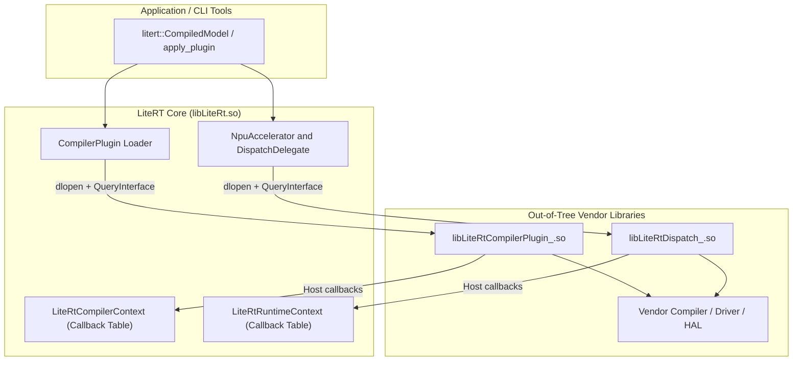

# Build Your Own NPU Backend

SoC vendors and accelerator developers can build and ship an NPU backend
outside the LiteRT repository. A backend ships as one or two standalone shared
libraries compiled only against LiteRT's C headers:

*   `libLiteRtDispatch_<Vendor>.so` for on-device graph execution.
*   `libLiteRtCompilerPlugin_<Vendor>.so` for ahead-of-time (AOT) or on-device
    JIT compilation.

Neither library requires source changes, vendor enums, build flags, or registry
entries in LiteRT.

## Table of Contents

1. [How Out-of-Tree Backends Work](#1-how-out-of-tree-backends-work)
2. [ABI-Stable C Interface Guarantees](#2-abi-stable-c-interface-guarantees)
3. [Library Naming, Symbol Visibility, and Discovery](#3-library-naming-symbol-visibility-and-discovery)
4. [Implementing `libLiteRtDispatch_<Vendor>.so`](#4-implementing-liblitertdispatch_vendorso)
5. [Implementing `libLiteRtCompilerPlugin_<Vendor>.so`](#5-implementing-liblitertcompilerplugin_vendorso)
6. [Passing Vendor Options (`LiteRtOpaqueOptions`)](#6-passing-vendor-options-litertopaqueoptions)
7. [Building Out-of-Tree (CMake and Bazel)](#7-building-out-of-tree-cmake-and-bazel)
8. [Testing and Benchmarking](#8-testing-and-benchmarking)
9. [Reference Docs and Vendor Examples](#9-reference-docs-and-vendor-examples)

---

## 1. How Out-of-Tree Backends Work

LiteRT separates hardware compilation from on-device execution across two C ABI
boundaries:

*   **Compiler Plugin (`libLiteRtCompilerPlugin_<Vendor>.so`):** Reads a
    `.tflite` model, optionally runs graph rewrites, selects supported ops
    (`partition`), and calls your vendor compiler SDK to emit NPU bytecode or
    an in-memory JIT executable (`compile`).
*   **Dispatch Runtime (`libLiteRtDispatch_<Vendor>.so`):** Opens NPU device
    contexts, reports tensor buffer requirements (`AHardwareBuffer`, `DmaBuf`,
    `FastRpc`, or custom vendor memory), binds buffers or sync fences, and runs
    compiled `DISPATCH_OP` subgraphs.



### Runtime Discovery Without LiteRT Edits

1.  **Built-in NPU Accelerator:** Every `LiteRtEnvironment` registers the
    generic `NpuAccelerator` (`kLiteRtHwAcceleratorNpu`). When a caller
    requests NPU execution, `DispatchDelegate` scans
    `kLiteRtEnvOptionTagDispatchLibraryDir` and loads
    `libLiteRtDispatch_<Vendor>.so` with `dlopen`.
2.  **Runtime SoC String Matching:** The compiler plugin loader scans
    `kLiteRtEnvOptionTagCompilerPluginLibraryDir` (or `--libs` in
    `apply_plugin`), loads every `libLiteRtCompilerPlugin_*.so`, and queries
    `get_compiler_plugin_soc_manufacturer()` and
    `get_compiler_plugin_supported_soc_model()`. Strings such as `"AcmeCorp"`
    and `"AcmeNpuGen1"` work directly in CLI tools and SDK APIs without adding
    an enum to LiteRT.
3.  **Automatic CPU/GPU Fallback:** Ops not selected by your compiler plugin
    stay in the parent `.tflite` graph for CPU (XNNPACK) or GPU (ML Drift)
    execution. LiteRT handles buffer copies and sync fences across subgraph
    boundaries.

### Staged Bring-Up Path

Most teams bring up a backend in three stages:

| Stage | Library Built | Model Preparation | Milestone |
| :--- | :--- | :--- | :--- |
| **1. Dispatch only** | `libLiteRtDispatch_<Vendor>.so` | Compile offline with vendor SDK; wrap via [`build_custom_npu_model_main`](./tools/README.md#build_custom_npu_model_main) | On-device NPU execution via `run_model` |
| **2. Offline AOT** | Host `libLiteRtCompilerPlugin_<Vendor>.so` | Partition and compile `.tflite` with [`apply_plugin`](./tools/README.md#apply_plugin) | Automated partitioning and CPU+NPU fallback |
| **3. On-device JIT** | Device `libLiteRtCompilerPlugin_<Vendor>.so` | Pass standard `.tflite` to `CompiledModel::Create` | On-device compilation and [JIT handoff](./JIT_COMPILATION.md) |

---

## 2. ABI-Stable C Interface Guarantees

LiteRT's vendor headers
([`vendors/c/litert_dispatch_api.h`](./vendors/c/litert_dispatch_api.h) and
[`vendors/c/litert_compiler_plugin_api.h`](./vendors/c/litert_compiler_plugin_api.h))
give out-of-tree libraries the same runtime and compiler hooks used by in-tree
backends, while keeping binaries compatible across independent app and driver
updates.

### 2.1 Forward and Backward Binary Compatibility

On Android, Linux, and IoT devices, the app-bundled runtime (`libLiteRt.so`)
and the OEM-shipped NPU driver (`libLiteRtDispatch_<Vendor>.so`) update on
different schedules. LiteRT handles version skew in both directions:

*   **Newer LiteRT + Older Vendor `.so`:** LiteRT checks the vendor table's
    `LiteRtAbiHeader` at offset `0` (`struct_size`, `major_version`,
    `minor_version`) with `LITERT_ABI_HAS_API` before calling any optional
    pointer, falling back when a newer hook is absent.
*   **Older LiteRT + Newer Vendor `.so`:** `QueryInterface` returns a `const
    void*` (`LiteRtInterface`) pointing to static `.rodata` inside the vendor
    `.so` instead of copying into a caller stack struct, avoiding struct
    slicing or buffer overruns. When the vendor `.so` calls back into an older
    host's `LiteRtRuntimeContext` or `LiteRtCompilerContext`,
    `LITERT_ABI_HAS_API` prevents reading past the older host's `struct_size`.

### 2.2 `LiteRtAbiHeader` and Append-Only `_V1` Structs

Every versioned struct across both boundaries starts with an 8-byte
`LiteRtAbiHeader` at byte offset `0`
([`c/internal/litert_abi_header.h`](./c/internal/litert_abi_header.h)):

```c
typedef struct LiteRtAbiHeader {
  uint16_t struct_size;    // sizeof(ParentStruct), up to 64 KB
  uint16_t major_version;  // Bumped only on incompatible _V2 layout changes
  uint16_t minor_version;  // Bumped when appending function pointers
  uint16_t reserved;       // Must be 0
} LiteRtAbiHeader;
```

Within major version `1`, all interface tables (`LiteRtDispatchInterface_V1`,
`LiteRtDispatchAsyncInterface_V1`, `LiteRtDispatchGraphInterface_V1`,
`LiteRtCustomTensorBufferHandlersDef_V1`, `LiteRtCompilerPluginInterface_V1`,
`LiteRtRuntimeContext`, and `LiteRtCompilerContext`) are append-only:

*   Existing fields are never reordered, removed, or changed in signature.
*   New hooks are added at the end of the struct (such as
    `device_context_set_expected_functions` in `LiteRtDispatchInterface_V1`, or
    `create_tensor_buffer_requirements_with_alignment` in
    `LiteRtRuntimeContext` v1.3.0).
*   Callers check `LITERT_ABI_HAS_API(table_ptr, /*req_major=*/1, member)`
    before invoking any post-`1.0` pointer. The macro verifies that `table_ptr`
    is non-null, `major_version == 1`, `member` fits within `struct_size`, and
    `table_ptr->member != NULL`.

> [!IMPORTANT]
> Do not check `runtime_context->some_new_fn != NULL` directly for functions
> added after `1.0.0`. Use `LITERT_ABI_HAS_API(ctx, 1, some_new_fn)` so your
> library never reads past `ctx->abi_header.struct_size` on an older host.

### 2.3 No `libLiteRt.so` Link Dependency

Neither `libLiteRtDispatch_<Vendor>.so` nor
`libLiteRtCompilerPlugin_<Vendor>.so` links against `libLiteRt.so`. Instead,
LiteRT passes a host callback vtable into each entry point:

*   **Dispatch receives `const LiteRtRuntimeContext*`**
    ([`c/internal/litert_runtime_context.h`](./c/internal/litert_runtime_context.h)):
    Callbacks for creating `LiteRtTensorBufferRequirements` (including byte
    alignment and strides), locking host memory, extracting zero-copy hardware
    handles (`AHardwareBuffer*`, DMA-BUF `fd`, FastRPC `fd`, `HwMemoryHandle`,
    OpenCL/GL handles), managing `LiteRtEvent` sync fences, and reading
    `LiteRtEnvironmentOptions` and `LiteRtOpaqueOptions`.
*   **Compiler Plugin receives `const LiteRtCompilerContext*`**
    ([`c/internal/litert_compiler_context.h`](./c/internal/litert_compiler_context.h)):
    Callbacks for inspecting subgraphs, ops, tensor shapes, quantization
    parameters (per-tensor, per-channel, block-wise), constant weights,
    StableHLO composites, op attributes, and `LiteRtBuilder` graph rewrites.

Because the vendor `.so` has no `DT_NEEDED` entry for `libLiteRt.so`, the same
binary works whether an app links LiteRT statically, bundles `libLiteRt.so` in
its APK, or loads LiteRT via Google Play services. See
[LiteRT Runtime Decoupling with RuntimeContext](https://github.com/google-ai-edge/LiteRT/blob/main/docs/apis/runtime_context.md).

### 2.4 Single Exported C Symbol and Toolchain Isolation

Each shared library exports one C function and hides all internal symbols
(`-fvisibility=hidden` plus a linker version script):

*   Dispatch: `LiteRtDispatchQueryInterface`
*   Compiler plugin: `LiteRtCompilerPluginQueryInterface`

This boundary gives two practical guarantees:

*   **No C++ ODR or STL conflicts:** Your library can statically link its own
    version of `libc++`, `libstdc++`, Abseil, Protobuf, FlatBuffers, or LLVM
    without colliding with the host app or LiteRT.
*   **Pure C11 headers:** Every shared header compiles cleanly as C11 (verified
    in [`vendors/c/litert_vendor_c_api_common_test.c`](./vendors/c/litert_vendor_c_api_common_test.c)),
    so you can write your backend in C11, C++, or Rust FFI.

### 2.5 Dispatch Sub-Interfaces

`LiteRtDispatchQueryInterface` requires `kLiteRtInterfaceBasic` and lets
backends opt into additional sub-interfaces independently:

| Interface ID | Struct Type | Scope |
| :--- | :--- | :--- |
| `kLiteRtInterfaceBasic` (`0`) | `LiteRtDispatchInterface_V1` | Required: contexts, buffer requirements, `fd` mmap loading, scheduling, metrics |
| `kLiteRtInterfaceAsync` (`1`) | `LiteRtDispatchAsyncInterface_V1` | Optional: `LiteRtEvent` sync-fence execution (`invoke_async`) and multi-inflight runs |
| `kLiteRtInterfaceCustomTensorBufferHandlers` (`3`) | `LiteRtCustomTensorBufferHandlersDef_V1` | Optional: custom NPU buffer allocators and `lock`/`unlock` (`100..199`) |
| `kLiteRtInterfaceGraph` (`2`) | `LiteRtDispatchGraphInterface_V1` | Optional: multi-node execution graphs and scratchpad buffer negotiation |

---

## 3. Library Naming, Symbol Visibility, and Discovery

LiteRT locates vendor libraries by scanning directories in
[`core/dynamic_loading.cc`](./core/dynamic_loading.cc) and
[`core/dynamic_loading_windows.cc`](./core/dynamic_loading_windows.cc).

### 3.1 Platform Naming Rules

| Platform | Dispatch Filename | Compiler Plugin Filename | Linker Flags |
| :--- | :--- | :--- | :--- |
| **Linux / Android** | `libLiteRtDispatch_<Vendor>.so` | `libLiteRtCompilerPlugin_<Vendor>.so` | `-fPIC -fvisibility=hidden` + `.lds` script |
| **macOS** | `libLiteRtDispatch_<Vendor>.dylib` (or `.so`) | `libLiteRtCompilerPlugin_<Vendor>.dylib` (or `.so`) | `-fPIC -fvisibility=hidden -Wl,-exported_symbols_list,...` |
| **Windows** | `LiteRtDispatch_<Vendor>.dll` (or `lib...`) | `LiteRtCompilerPlugin_<Vendor>.dll` (or `lib...`) | `-DLITERT_COMPILE_LIBRARY` (`__declspec(dllexport)`) |

Additional platform requirements:

*   **Android 15+ (16 KB page size):** Pass `-Wl,-z,max-page-size=16384` and
    `-Wl,-z,common-page-size=16384` when linking Android shared libraries.
*   **No versioned `.so` suffixes:** The scanner matches filenames ending in
    `.so` (or `.dylib` / `.dll`), so `libLiteRtDispatch_Acme.so.1` is ignored.
*   **One Dispatch `.so` per directory:** `LiteRtDispatchInitialize` loads the
    first matching `libLiteRtDispatch*.so` in
    `kLiteRtEnvOptionTagDispatchLibraryDir`. Put only one vendor's Dispatch
    `.so` in that directory. Multiple `libLiteRtCompilerPlugin_*.so` files can
    share a single compiler plugin directory.

### 3.2 Linker Version Scripts

Restrict exported symbols to the query entry point, following
[`build_common/export_litert_only_linux.lds`](./build_common/export_litert_only_linux.lds)
and
[`build_common/export_litert_only_darwin.lds`](./build_common/export_litert_only_darwin.lds).
Keep the trailing `*` glob if both targets share one script; Android NDK's
`lld` enables `--no-undefined-version` by default and rejects exact symbol
names that are absent from a dispatch-only or plugin-only DSO.

**Linux / Android (`acme_litert_exports.lds`):**

```text
VERS_1.0 {
  global:
    LiteRtDispatchQueryInterface*;
    LiteRtCompilerPluginQueryInterface*;
  local:
    *;
};
```

**macOS (`acme_litert_exports.exp`):**

```text
*LiteRtDispatchQueryInterface
*LiteRtCompilerPluginQueryInterface
```

### 3.3 Pointing `litert::Environment` at Your Libraries

Applications pass your library directory through `EnvironmentOptions`:

```cpp
#include <array>
#include "litert/cc/litert_common.h"
#include "litert/cc/litert_compiled_model.h"
#include "litert/cc/litert_environment.h"
#include "litert/cc/litert_environment_options.h"

const std::array<litert::EnvironmentOptions::Option, 2> env_options = {
    litert::EnvironmentOptions::Option{
        litert::EnvironmentOptions::Tag::kDispatchLibraryDir,
        "/vendor/lib64/acme_npu",  // Contains libLiteRtDispatch_Acme.so
    },
    litert::EnvironmentOptions::Option{
        litert::EnvironmentOptions::Tag::kCompilerPluginLibraryDir,
        "/vendor/lib64/acme_npu",  // Optional: for on-device JIT
    },
};

LITERT_ASSIGN_OR_RETURN(
    auto env,
    litert::Environment::Create(litert::EnvironmentOptions(env_options)));

LITERT_ASSIGN_OR_RETURN(
    auto compiled_model,
    litert::CompiledModel::Create(env, "model.tflite",
                                  litert::HwAccelerators::kNpu));
```

---

## 4. Implementing `libLiteRtDispatch_<Vendor>.so`

See [DISPATCH_API.md](./DISPATCH_API.md) for sequence diagrams and full
function specifications.

### 4.1 Header-Only Includes

*   [`vendors/c/litert_dispatch_api.h`](./vendors/c/litert_dispatch_api.h)
*   [`c/internal/litert_abi_header.h`](./c/internal/litert_abi_header.h)
*   [`c/internal/litert_runtime_context.h`](./c/internal/litert_runtime_context.h)
*   [`c/internal/litert_custom_tensor_buffer_handlers_def.h`](./c/internal/litert_custom_tensor_buffer_handlers_def.h)
    (optional, for custom vendor tensor buffers)

### 4.2 Lifecycle and Multi-Environment Behavior

1.  **Process-Once `initialize`:** LiteRT loads `libLiteRtDispatch_<Vendor>.so`
    and calls `initialize` once per process. Load your low-level NPU driver
    (`dlopen`) here, and do not cache the `LiteRtEnvironment` pointer globally
    in case the app creates multiple environments. Instead, use the
    `runtime_context` passed to `device_context_create` and
    `invocation_context_create`.
2.  **Per-Environment Custom Buffer Registration:** If
    `LiteRtDispatchQueryInterface` returns a
    `LiteRtCustomTensorBufferHandlersDef_V1` table for
    `kLiteRtInterfaceCustomTensorBufferHandlers`, LiteRT registers those buffer
    handlers (`create_func`, `destroy_func`, `lock_func`, `unlock_func`, plus
    optional `clear_func` and `import_func`) on every `LiteRtEnvironment` in
    the process, including environments created after `initialize` has run.
3.  **Model Session (`device_context_create` / `device_context_destroy`):**
    Created once per `CompiledModel` delegate instance. Store your NPU device
    handle, shared context binaries, and registered buffer map here.
4.  **Selected Signatures Hint (`device_context_set_expected_functions`):**
    Optional `_V1` hook called before `invocation_context_create` when the
    caller filters signatures via `RuntimeOptions::SetSelectedSignatures()`.
    Use it to skip loading unused subgraphs from multi-entry NPU binaries.
5.  **Partition Context (`invocation_context_create` /
    `invocation_context_destroy`):** Created per `DISPATCH_OP` partition.
    *   `exec_type`: `kLiteRtDispatchExecutableTypeMlModel` for serialized
        bytecode, or `kLiteRtDispatchExecutableTypeJitHandle` for an in-memory
        pointer from `get_compiled_result_handle` (see
        [JIT Compilation](./JIT_COMPILATION.md)).
    *   `exec_bytecode_buffer` (`LiteRtMemBuffer`): Carries both memory
        pointers (`base_addr`, `offset`, `size`) and file-descriptor metadata
        (`fd`, `alloc_base_file_offset`) so drivers can mmap weights directly
        from disk without extra heap copies.
    *   `function_name`: Entry-point string emitted by your compiler plugin's
        `get_compiled_result_call_info`.
6.  **Buffer Handshake and Execution:**
    *   `get_input_requirements` / `get_output_requirements`: Report supported
        `LiteRtTensorBufferType`s in priority order, padded byte size, strides,
        and byte alignment.
    *   `register_tensor_buffer` / `unregister_tensor_buffer`: Map a
        `LiteRtTensorBuffer` into NPU memory once on `device_context` and
        return a `LiteRtTensorBufferHandle`.
    *   `attach_input` / `attach_output`, then `invoke` (or
        `attach_input_event` and `invoke_async`), then `detach_input` /
        `detach_output`.

### 4.3 Compilable Dispatch Skeleton (`acme_dispatch.cc`)

Compare against [`vendors/examples/example_dispatch.cc`](./vendors/examples/example_dispatch.cc):

```cpp
#include <cstddef>
#include <cstdint>
#include <unordered_map>

#include "litert/c/internal/litert_abi_header.h"
#include "litert/c/internal/litert_runtime_context.h"
#include "litert/c/litert_common.h"
#include "litert/c/litert_model_types.h"
#include "litert/c/litert_tensor_buffer_types.h"
#include "litert/vendors/c/litert_dispatch.h"
#include "litert/vendors/c/litert_dispatch_api.h"

struct LiteRtDispatchDeviceContextT {
  const LiteRtRuntimeContext* runtime_context = nullptr;
  uint64_t next_handle = 1;
  std::unordered_map<LiteRtTensorBufferHandle, LiteRtTensorBuffer> buffers;
};

struct LiteRtDispatchInvocationContextT {
  const LiteRtRuntimeContext* runtime_context = nullptr;
  LiteRtDispatchDeviceContext device_context = nullptr;
  int num_inputs = 0;
  int num_outputs = 0;
};

namespace {

LiteRtStatus AcmeInitialize(const LiteRtRuntimeContext* runtime_context,
                            LiteRtEnvironment env, LiteRtOptions options) {
  (void)runtime_context;
  (void)env;
  (void)options;
  return kLiteRtStatusOk;
}

LiteRtStatus AcmeGetVendorId(const char** vendor_id) {
  if (!vendor_id) return kLiteRtStatusErrorInvalidArgument;
  *vendor_id = "AcmeCorp";
  return kLiteRtStatusOk;
}

LiteRtStatus AcmeGetBuildId(const char** build_id) {
  if (!build_id) return kLiteRtStatusErrorInvalidArgument;
  *build_id = "acme-dispatch-1.0.0";
  return kLiteRtStatusOk;
}

LiteRtStatus AcmeGetCapabilities(int* capabilities) {
  if (!capabilities) return kLiteRtStatusErrorInvalidArgument;
  *capabilities = kLiteRtDispatchCapabilitiesBasic;
  return kLiteRtStatusOk;
}

LiteRtStatus AcmeCheckRuntimeCompatibility(LiteRtApiVersion api_version,
                                           LiteRtEnvironmentOptions env,
                                           LiteRtOptions options) {
  (void)api_version;
  (void)env;
  (void)options;
  // Return kLiteRtStatusErrorRuntimeFailure if NPU hardware/driver is absent.
  return kLiteRtStatusOk;
}

LiteRtStatus AcmeDeviceContextCreate(
    const LiteRtRuntimeContext* runtime_context, LiteRtOptions options,
    LiteRtDispatchDeviceContext* device_context) {
  (void)options;
  if (!runtime_context || !device_context) {
    return kLiteRtStatusErrorInvalidArgument;
  }
  auto* ctx = new LiteRtDispatchDeviceContextT();
  ctx->runtime_context = runtime_context;
  *device_context = ctx;
  return kLiteRtStatusOk;
}

LiteRtStatus AcmeDeviceContextDestroy(
    LiteRtDispatchDeviceContext device_context) {
  delete device_context;
  return kLiteRtStatusOk;
}

LiteRtStatus AcmeInvocationContextCreate(
    const LiteRtRuntimeContext* runtime_context,
    LiteRtDispatchDeviceContext device_context,
    LiteRtDispatchExecutableType exec_type,
    const LiteRtMemBuffer* exec_bytecode_buffer, const char* function_name,
    int num_inputs, int num_outputs,
    LiteRtDispatchInvocationContext* invocation_context) {
  if (!runtime_context || !device_context || !exec_bytecode_buffer ||
      !invocation_context) {
    return kLiteRtStatusErrorInvalidArgument;
  }
  auto* inv = new LiteRtDispatchInvocationContextT();
  inv->runtime_context = runtime_context;
  inv->device_context = device_context;
  inv->num_inputs = num_inputs;
  inv->num_outputs = num_outputs;

  if (exec_type == kLiteRtDispatchExecutableTypeJitHandle) {
    // In-memory JIT pointer in exec_bytecode_buffer->base_addr.
  } else {
    // Bytecode at base_addr + offset (size bytes), or mmap via fd.
  }
  (void)function_name;
  *invocation_context = inv;
  return kLiteRtStatusOk;
}

LiteRtStatus AcmeInvocationContextDestroy(
    LiteRtDispatchInvocationContext invocation_context) {
  delete invocation_context;
  return kLiteRtStatusOk;
}

LiteRtStatus AcmeCreateRequirements(
    const LiteRtRuntimeContext* rctx, const LiteRtRankedTensorType* tensor_type,
    LiteRtTensorBufferRequirements* out_req) {
  static const LiteRtTensorBufferType kSupportedTypes[] = {
      kLiteRtTensorBufferTypeAhwb,
      kLiteRtTensorBufferTypeDmaBuf,
      kLiteRtTensorBufferTypeHostMemory,
  };
  const size_t byte_size = 4096;  // Replace with padded NPU tensor byte size.
  const size_t alignment = 128;   // Hardware DMA alignment in bytes.
  (void)tensor_type;

  // Guard post-1.0 RuntimeContext functions with LITERT_ABI_HAS_API so the
  // library still runs on LiteRT 1.0..1.2 hosts.
  if (LITERT_ABI_HAS_API(rctx, /*req_major=*/1,
                         create_tensor_buffer_requirements_with_alignment)) {
    return rctx->create_tensor_buffer_requirements_with_alignment(
        /*num_supported_tensor_buffer_types=*/3, kSupportedTypes, byte_size,
        /*num_strides=*/0, /*strides=*/nullptr, alignment, out_req);
  }
  return rctx->create_tensor_buffer_requirements(
      /*num_supported_tensor_buffer_types=*/3, kSupportedTypes, byte_size,
      /*num_strides=*/0, /*strides=*/nullptr, out_req);
}

LiteRtStatus AcmeGetInputRequirements(
    LiteRtDispatchInvocationContext invocation_context, int input_index,
    const LiteRtRankedTensorType* tensor_type,
    LiteRtTensorBufferRequirements* tensor_buffer_requirements) {
  (void)input_index;
  return AcmeCreateRequirements(invocation_context->runtime_context,
                                tensor_type, tensor_buffer_requirements);
}

LiteRtStatus AcmeGetOutputRequirements(
    LiteRtDispatchInvocationContext invocation_context, int output_index,
    const LiteRtRankedTensorType* tensor_type,
    LiteRtTensorBufferRequirements* tensor_buffer_requirements) {
  (void)output_index;
  return AcmeCreateRequirements(invocation_context->runtime_context,
                                tensor_type, tensor_buffer_requirements);
}

LiteRtStatus AcmeRegisterTensorBuffer(
    LiteRtDispatchDeviceContext device_context, LiteRtTensorBuffer buffer,
    LiteRtTensorBufferHandle* tensor_buffer_handle) {
  if (!device_context || !buffer || !tensor_buffer_handle) {
    return kLiteRtStatusErrorInvalidArgument;
  }
  // Query buffer handle via runtime_context (get_tensor_buffer_ahwb,
  // get_tensor_buffer_dma_buf_buffer, etc.) and map into NPU memory once.
  const LiteRtTensorBufferHandle handle = device_context->next_handle++;
  device_context->buffers[handle] = buffer;
  *tensor_buffer_handle = handle;
  return kLiteRtStatusOk;
}

LiteRtStatus AcmeUnregisterTensorBuffer(
    LiteRtDispatchDeviceContext device_context,
    LiteRtTensorBufferHandle handle) {
  if (!device_context) return kLiteRtStatusErrorInvalidArgument;
  device_context->buffers.erase(handle);
  return kLiteRtStatusOk;
}

LiteRtStatus AcmeAttachInput(LiteRtDispatchInvocationContext invocation_context,
                             int graph_input_index,
                             LiteRtTensorBufferHandle handle) {
  (void)invocation_context;
  (void)graph_input_index;
  (void)handle;
  return kLiteRtStatusOk;
}

LiteRtStatus AcmeAttachOutput(
    LiteRtDispatchInvocationContext invocation_context, int graph_output_index,
    LiteRtTensorBufferHandle handle) {
  (void)invocation_context;
  (void)graph_output_index;
  (void)handle;
  return kLiteRtStatusOk;
}

LiteRtStatus AcmeDetachInput(LiteRtDispatchInvocationContext, int,
                             LiteRtTensorBufferHandle) {
  return kLiteRtStatusOk;
}

LiteRtStatus AcmeDetachOutput(LiteRtDispatchInvocationContext, int,
                              LiteRtTensorBufferHandle) {
  return kLiteRtStatusOk;
}

LiteRtStatus AcmeInvoke(LiteRtDispatchInvocationContext invocation_context) {
  if (!invocation_context) return kLiteRtStatusErrorInvalidArgument;
  return kLiteRtStatusOk;
}

const LiteRtDispatchInterface_V1 kAcmeDispatchInterfaceV1 = {
    .abi_header =
        {
            .struct_size = sizeof(LiteRtDispatchInterface_V1),
            .major_version = LITERT_DISPATCH_ABI_VERSION_MAJOR,
            .minor_version = LITERT_DISPATCH_ABI_VERSION_MINOR,
            .reserved = 0,
        },
    .initialize = AcmeInitialize,
    .get_vendor_id = AcmeGetVendorId,
    .get_build_id = AcmeGetBuildId,
    .get_capabilities = AcmeGetCapabilities,
    .device_context_create = AcmeDeviceContextCreate,
    .device_context_destroy = AcmeDeviceContextDestroy,
    .get_input_requirements = AcmeGetInputRequirements,
    .get_output_requirements = AcmeGetOutputRequirements,
    .register_tensor_buffer = AcmeRegisterTensorBuffer,
    .unregister_tensor_buffer = AcmeUnregisterTensorBuffer,
    .invocation_context_create = AcmeInvocationContextCreate,
    .invocation_context_destroy = AcmeInvocationContextDestroy,
    .invocation_context_set_scheduling_info = nullptr,
    .attach_input = AcmeAttachInput,
    .attach_output = AcmeAttachOutput,
    .detach_input = AcmeDetachInput,
    .detach_output = AcmeDetachOutput,
    .invoke = AcmeInvoke,
    .start_metrics_collection = nullptr,
    .stop_metrics_collection = nullptr,
    .get_num_metrics = nullptr,
    .get_metric = nullptr,
    .destroy_metrics = nullptr,
    .check_runtime_compatibility = AcmeCheckRuntimeCompatibility,
    .invocation_context_set_options = nullptr,
    .get_hooks = nullptr,
    .attach_edge_buffer = nullptr,
    .detach_edge_buffer = nullptr,
    .device_context_set_expected_functions = nullptr,
};

}  // namespace

extern "C" LITERT_CAPI_EXPORT LiteRtStatus LiteRtDispatchQueryInterface(
    LiteRtDispatchInterfaceId interface_id,
    LiteRtApiVersion litert_runtime_version, LiteRtInterface* out_interface) {
  if (!out_interface) {
    return kLiteRtStatusErrorInvalidArgument;
  }
  if (litert_runtime_version.major >= 1) {
    switch (interface_id) {
      case kLiteRtInterfaceBasic:
        *out_interface = &kAcmeDispatchInterfaceV1;
        return kLiteRtStatusOk;
      default:
        break;
    }
  }
  return kLiteRtStatusErrorUnsupported;
}
```

> [!TIP]
> **Custom Vendor Memory (`100..199`):** If your NPU allocator is not covered
> by `AHardwareBuffer`, `DmaBuf`, `Ion`, or `FastRpc`, pick an ID in
> `kLiteRtTensorBufferTypeUserCustomBuffer` (`100..199`, in
> [`c/litert_tensor_buffer_types.h`](./c/litert_tensor_buffer_types.h)) and
> return a `LiteRtCustomTensorBufferHandlersDef_V1` table for
> `kLiteRtInterfaceCustomTensorBufferHandlers`. See
> [Tensor Registration API](https://github.com/google-ai-edge/LiteRT/blob/main/docs/apis/tensor_buffer_registry.md)
> and [`vendors/intel_openvino/dispatch/`](./vendors/intel_openvino/dispatch/).

---

## 5. Implementing `libLiteRtCompilerPlugin_<Vendor>.so`

See [COMPILER_PLUGIN.md](./COMPILER_PLUGIN.md) and
[JIT_COMPILATION.md](./JIT_COMPILATION.md) for partitioning rules,
`odml.npu_call` / `odml.cpu_call` composite placement, and JIT flows.

### 5.1 Header-Only Includes

*   [`vendors/c/litert_compiler_plugin_api.h`](./vendors/c/litert_compiler_plugin_api.h)
*   [`c/internal/litert_abi_header.h`](./c/internal/litert_abi_header.h)
*   [`c/internal/litert_compiler_context.h`](./c/internal/litert_compiler_context.h)
*   [`compiler/cc/litert_model.h`](./compiler/cc/litert_model.h) (optional
    header-only C++ RAII views `litert::compiler::Model`, `Subgraph`, `Op`,
    `Tensor`, and `Weights` over `const LiteRtCompilerContext*`)

### 5.2 Plugin Responsibilities

1.  **Target Identification:**
    *   `get_compiler_plugin_soc_manufacturer()` returns your vendor string
        (such as `"AcmeCorp"`).
    *   `get_num_compiler_plugin_supported_models()` and
        `get_compiler_plugin_supported_soc_model()` list supported chip targets
        (such as `"AcmeNpuGen1"` and `"AcmeNpuGen2"`).
    *   `get_compiler_plugin_supported_hardware()` sets `*supported_hardware =
        kLiteRtHwAcceleratorNpu`.
2.  **Pre-Partition Graph Rewrites (`register_all_transformations`):**
    Optional hook to fuse or canonicalize ops before partitioning using
    `LiteRtBuilder` callbacks on `LiteRtCompilerContext`. See
    [PATTERN_MATCHING.md](./PATTERN_MATCHING.md) and
    [`vendors/examples/example_transformations.cc`](./vendors/examples/example_transformations.cc).
3.  **Partitioning (`compiler_plugin_partition`):**
    Check each `LiteRtOp`'s opcode, shapes, types, quantization, and attributes
    via `LiteRtCompilerContext`, and call
    `compiler_context->push_op(selected_ops, op, partition_index)` for
    supported ops. LiteRT groups connected ops into DAG partitions and honors
    `odml.npu_call` / `odml.cpu_call` overrides.
4.  **Compilation (`compiler_plugin_compile`):**
    Compiles each outlined subgraph in `LiteRtModel partitions` and returns a
    `LiteRtCompiledResult` using one of two layouts:
    *   **Single shared module:** Emit `num_byte_code = 1` with `*byte_code_idx
        = 0` for all calls and distinct `call_info` entry names, allowing
        weight deduplication across signatures.
    *   **Per-partition modules:** Emit `num_byte_code = N` with
        `*byte_code_idx = call_idx`.
    *   **In-memory JIT handle (optional):** Return a live
        `LiteRtJitExecutable` from `get_compiled_result_handle` during
        on-device JIT so Dispatch receives
        `kLiteRtDispatchExecutableTypeJitHandle` without bytecode
        serialization (set `*handle = nullptr` for offline AOT).

### 5.3 Compilable Compiler Plugin Skeleton (`acme_compiler_plugin.cc`)

Compare against [`vendors/examples/example_plugin.cc`](./vendors/examples/example_plugin.cc):

```cpp
#include <cstddef>
#include <string>
#include <vector>

#include "litert/c/internal/litert_abi_header.h"
#include "litert/c/internal/litert_compiler_context.h"
#include "litert/c/litert_common.h"
#include "litert/c/litert_op_code.h"
#include "litert/vendors/c/litert_compiler_plugin.h"
#include "litert/vendors/c/litert_compiler_plugin_api.h"

struct LiteRtCompilerPluginT {
  const LiteRtCompilerContext* ctx = nullptr;
};

struct LiteRtCompiledResultT {
  std::vector<std::string> byte_modules;
  std::vector<std::string> entry_points;
};

namespace {

constexpr const char* kSupportedSocModels[] = {"AcmeNpuGen1", "AcmeNpuGen2"};

LiteRtStatus AcmeGetPluginVersion(LiteRtApiVersion* version) {
  if (!version) return kLiteRtStatusErrorInvalidArgument;
  *version = {1, 0, 0};
  return kLiteRtStatusOk;
}

const char* AcmeGetSocManufacturer() { return "AcmeCorp"; }

LiteRtStatus AcmeGetSdkVersion(LiteRtCompilerPlugin plugin,
                               const char** sdk_version) {
  if (!plugin || !sdk_version) return kLiteRtStatusErrorInvalidArgument;
  *sdk_version = "acme-compiler-sdk-1.0.0";
  return kLiteRtStatusOk;
}

LiteRtStatus AcmeCreatePlugin(const LiteRtCompilerContext* compiler_context,
                              LiteRtCompilerPlugin* compiler_plugin,
                              LiteRtEnvironmentOptions env,
                              LiteRtOptions options) {
  (void)env;
  (void)options;
  if (!compiler_context || !compiler_plugin) {
    return kLiteRtStatusErrorInvalidArgument;
  }
  auto* plugin = new LiteRtCompilerPluginT();
  plugin->ctx = compiler_context;
  *compiler_plugin = plugin;
  return kLiteRtStatusOk;
}

void AcmeDestroyPlugin(LiteRtCompilerPlugin plugin) { delete plugin; }

LiteRtStatus AcmeGetSupportedHardware(LiteRtCompilerPlugin plugin,
                                      LiteRtHwAccelerators* hw) {
  if (!plugin || !hw) return kLiteRtStatusErrorInvalidArgument;
  *hw = kLiteRtHwAcceleratorNpu;
  return kLiteRtStatusOk;
}

LiteRtStatus AcmeGetNumSocModels(LiteRtCompilerPlugin plugin,
                                 LiteRtParamIndex* num_models) {
  if (!plugin || !num_models) return kLiteRtStatusErrorInvalidArgument;
  *num_models = sizeof(kSupportedSocModels) / sizeof(kSupportedSocModels[0]);
  return kLiteRtStatusOk;
}

LiteRtStatus AcmeGetSocModel(LiteRtCompilerPlugin plugin, LiteRtParamIndex idx,
                             const char** model_name) {
  if (!plugin || !model_name) return kLiteRtStatusErrorInvalidArgument;
  constexpr size_t kCount =
      sizeof(kSupportedSocModels) / sizeof(kSupportedSocModels[0]);
  if (idx >= kCount) return kLiteRtStatusErrorUnsupported;
  *model_name = kSupportedSocModels[idx];
  return kLiteRtStatusOk;
}

LiteRtStatus AcmeCheckCompilerCompatibility(LiteRtApiVersion api_version,
                                            LiteRtCompilerPlugin plugin,
                                            LiteRtEnvironmentOptions env,
                                            LiteRtOptions options,
                                            const char* soc_model_name) {
  (void)api_version;
  (void)plugin;
  (void)env;
  (void)options;
  (void)soc_model_name;
  return kLiteRtStatusOk;
}

LiteRtStatus AcmePartition(LiteRtCompilerPlugin plugin, const char* soc_model,
                           LiteRtSubgraph subgraph, LiteRtOpList selected_ops) {
  (void)soc_model;
  if (!plugin || !subgraph || !selected_ops) {
    return kLiteRtStatusErrorInvalidArgument;
  }
  const LiteRtCompilerContext* ctx = plugin->ctx;

  LiteRtParamIndex num_ops = 0;
  if (ctx->get_num_subgraph_ops(subgraph, &num_ops) != kLiteRtStatusOk) {
    return kLiteRtStatusErrorRuntimeFailure;
  }

  for (LiteRtParamIndex i = 0; i < num_ops; ++i) {
    LiteRtOp op = nullptr;
    ctx->get_subgraph_op(subgraph, i, &op);
    LiteRtOpCode opcode = kLiteRtOpCodeTflCustom;
    ctx->get_op_code(op, &opcode);

    if (opcode == kLiteRtOpCodeTflAdd || opcode == kLiteRtOpCodeTflMul ||
        opcode == kLiteRtOpCodeTflConv2d) {
      ctx->push_op(selected_ops, op, /*partition_index=*/0);
    }
  }
  return kLiteRtStatusOk;
}

LiteRtStatus AcmeCompile(LiteRtCompilerPlugin plugin, const char* soc_model,
                         LiteRtModel partitions,
                         LiteRtCompiledResult* compiled_result) {
  (void)soc_model;
  if (!plugin || !partitions || !compiled_result) {
    return kLiteRtStatusErrorInvalidArgument;
  }
  const LiteRtCompilerContext* ctx = plugin->ctx;

  LiteRtParamIndex num_subgraphs = 0;
  ctx->get_num_model_subgraphs(partitions, &num_subgraphs);

  auto* result = new LiteRtCompiledResultT();
  result->byte_modules.resize(num_subgraphs);
  result->entry_points.resize(num_subgraphs);

  for (LiteRtParamIndex i = 0; i < num_subgraphs; ++i) {
    LiteRtSubgraph partition_subgraph = nullptr;
    ctx->get_model_subgraph(partitions, i, &partition_subgraph);
    // Run vendor compiler SDK on partition_subgraph here.
    result->byte_modules[i] = "<compiled-acme-npu-binary>";
    result->entry_points[i] = "partition_" + std::to_string(i);
  }

  *compiled_result = result;
  return kLiteRtStatusOk;
}

void AcmeDestroyCompiledResult(LiteRtCompiledResult result) { delete result; }

LiteRtStatus AcmeGetNumByteCodeModules(LiteRtCompiledResult result,
                                       LiteRtParamIndex* num_byte_code) {
  if (!result || !num_byte_code) return kLiteRtStatusErrorInvalidArgument;
  *num_byte_code = result->byte_modules.size();
  return kLiteRtStatusOk;
}

LiteRtStatus AcmeGetByteCode(LiteRtCompiledResult result, LiteRtParamIndex idx,
                             const void** byte_code, size_t* byte_code_size) {
  if (!result || !byte_code || !byte_code_size ||
      idx >= result->byte_modules.size()) {
    return kLiteRtStatusErrorIndexOOB;
  }
  *byte_code = result->byte_modules[idx].data();
  *byte_code_size = result->byte_modules[idx].size();
  return kLiteRtStatusOk;
}

LiteRtStatus AcmeGetNumCalls(LiteRtCompiledResult result,
                             LiteRtParamIndex* num_calls) {
  if (!result || !num_calls) return kLiteRtStatusErrorInvalidArgument;
  *num_calls = result->entry_points.size();
  return kLiteRtStatusOk;
}

LiteRtStatus AcmeGetCallInfo(LiteRtCompiledResult result,
                             LiteRtParamIndex call_idx, const void** call_info,
                             size_t* call_info_size,
                             LiteRtParamIndex* byte_code_idx) {
  if (!result || !call_info || !call_info_size || !byte_code_idx ||
      call_idx >= result->entry_points.size()) {
    return kLiteRtStatusErrorIndexOOB;
  }
  *call_info = result->entry_points[call_idx].data();
  *call_info_size = result->entry_points[call_idx].size();
  *byte_code_idx = call_idx;
  return kLiteRtStatusOk;
}

LiteRtStatus AcmeGetCompiledResultHandle(LiteRtCompiledResult result,
                                         LiteRtParamIndex call_idx,
                                         LiteRtJitExecutable* handle) {
  (void)result;
  (void)call_idx;
  if (!handle) return kLiteRtStatusErrorInvalidArgument;
  *handle = nullptr;  // Non-null only for in-memory on-device JIT.
  return kLiteRtStatusOk;
}

const LiteRtCompilerPluginInterface_V1 kAcmeCompilerPluginInterfaceV1 = {
    .abi_header =
        {
            .struct_size = sizeof(LiteRtCompilerPluginInterface_V1),
            .major_version = LITERT_COMPILER_PLUGIN_ABI_VERSION_MAJOR,
            .minor_version = LITERT_COMPILER_PLUGIN_ABI_VERSION_MINOR,
            .reserved = 0,
        },
    .get_compiler_plugin_version = AcmeGetPluginVersion,
    .get_compiler_plugin_soc_manufacturer = AcmeGetSocManufacturer,
    .create_compiler_plugin = AcmeCreatePlugin,
    .destroy_compiler_plugin = AcmeDestroyPlugin,
    .get_compiler_plugin_supported_hardware = AcmeGetSupportedHardware,
    .get_num_compiler_plugin_supported_models = AcmeGetNumSocModels,
    .get_compiler_plugin_supported_soc_model = AcmeGetSocModel,
    .compiler_plugin_partition = AcmePartition,
    .compiler_plugin_compile = AcmeCompile,
    .destroy_compiled_result = AcmeDestroyCompiledResult,
    .get_compiled_result_byte_code = AcmeGetByteCode,
    .get_compiled_result_num_byte_code = AcmeGetNumByteCodeModules,
    .get_compiled_result_call_info = AcmeGetCallInfo,
    .get_num_compiled_result_calls = AcmeGetNumCalls,
    .register_all_transformations = nullptr,
    .get_compiler_plugin_sdk_version = AcmeGetSdkVersion,
    .get_compiled_result_handle = AcmeGetCompiledResultHandle,
    .check_compiler_compatibility = AcmeCheckCompilerCompatibility,
};

}  // namespace

extern "C" LITERT_CAPI_EXPORT LiteRtStatus LiteRtCompilerPluginQueryInterface(
    LiteRtCompilerPluginInterfaceId interface_id,
    LiteRtApiVersion litert_runtime_version, LiteRtInterface* out_interface) {
  if (!out_interface) {
    return kLiteRtStatusErrorInvalidArgument;
  }
  if (litert_runtime_version.major >= 1 &&
      interface_id == kLiteRtCompilerPluginInterfaceBasic) {
    *out_interface = &kAcmeCompilerPluginInterfaceV1;
    return kLiteRtStatusOk;
  }
  return kLiteRtStatusErrorUnsupported;
}
```

---

## 6. Passing Vendor Options (`LiteRtOpaqueOptions`)

Hardware backends often need vendor-specific settings such as clock/power
profiles (`burst`, `sustained`, `low_power`), SRAM/VTCM sizes, or FP16
accumulation modes. `LiteRtOpaqueOptions`
([`c/litert_opaque_options.h`](./c/litert_opaque_options.h) and
[`c/litert_options.h`](./c/litert_options.h)) passes compile-time, model-load,
and per-run (`CompiledModel::Run`) options from app code to your libraries
without adding vendor option headers to LiteRT:

1.  Pick a unique `payload_identifier` (such as `"acme_npu_options"`).
2.  Serialize settings as a null-terminated TOML string (recommended for
    automatic compilation-cache hashing and language-neutral layout) and attach
    it via `LiteRtCreateOpaqueOptions` + `LiteRtAddOpaqueOptions`.
3.  Read the payload inside Dispatch (`runtime_context`) or Compiler Plugin
    (`compiler_context`):

```cpp
// Producer (app or vendor header-only helper):
const char* kTomlPayload = "perf_mode = \"burst\"\nvtcm_mb = 8\n";
char* owned_copy = strdup(kTomlPayload);

LiteRtOpaqueOptions opaque_opts = nullptr;
LiteRtCreateOpaqueOptions("acme_npu_options", owned_copy, &free, &opaque_opts);
LiteRtAddOpaqueOptions(litert_options, opaque_opts);
```

```cpp
// Consumer (inside device_context_create, invocation_context_set_options,
// or create_compiler_plugin; no libLiteRt.so link dependency):
LiteRtOpaqueOptions head = nullptr;
if (options != nullptr &&
    runtime_context->get_opaque_options(options, &head) == kLiteRtStatusOk) {
  void* payload_data = nullptr;
  if (runtime_context->find_opaque_options_data(
          head, "acme_npu_options", &payload_data) == kLiteRtStatusOk) {
    const char* toml_str = static_cast<const char*>(payload_data);
    // Parse key-value settings from toml_str.
  }
}
```

See
[LiteRT OpaqueOptions (TOML) Design Guide](https://github.com/google-ai-edge/LiteRT/blob/main/docs/apis/opaque_options_toml.md)
and the option wrappers in [`c/options/`](./c/options/) and
[`cc/options/`](./cc/options/).

---

## 7. Building Out-of-Tree (CMake and Bazel)

Your build only needs LiteRT's C headers (plus
`tensorflow/lite/c/c_api_types.h`) and your vendor SDK libraries.

### 7.1 Standalone `CMakeLists.txt`

```cmake
cmake_minimum_required(VERSION 3.20)
project(acme_litert_npu_backend LANGUAGES C CXX)

set(CMAKE_CXX_STANDARD 20)
set(CMAKE_CXX_STANDARD_REQUIRED ON)
set(CMAKE_POSITION_INDEPENDENT_CODE ON)
set(CMAKE_CXX_VISIBILITY_PRESET hidden)
set(CMAKE_C_VISIBILITY_PRESET hidden)
set(CMAKE_VISIBILITY_INLINES_HIDDEN ON)

set(LITERT_REPO_ROOT "/path/to/LiteRT" CACHE PATH "Root of LiteRT headers")
set(ACME_SDK_ROOT "/path/to/acme_npu_sdk" CACHE PATH "Root of Acme NPU SDK")

function(configure_litert_vendor_dso TARGET_NAME OUTPUT_BASENAME)
  target_include_directories(${TARGET_NAME} PRIVATE
    "${LITERT_REPO_ROOT}"
    "${ACME_SDK_ROOT}/include"
  )
  set_target_properties(${TARGET_NAME} PROPERTIES
    OUTPUT_NAME "${OUTPUT_BASENAME}"
  )
  if(WIN32)
    target_compile_definitions(${TARGET_NAME} PRIVATE LITERT_COMPILE_LIBRARY)
  elseif(APPLE)
    target_link_options(${TARGET_NAME} PRIVATE
      "-Wl,-exported_symbols_list,${CMAKE_CURRENT_SOURCE_DIR}/acme_litert_exports.exp"
    )
  elseif(UNIX)
    target_link_options(${TARGET_NAME} PRIVATE
      "-Wl,--version-script=${CMAKE_CURRENT_SOURCE_DIR}/acme_litert_exports.lds"
      "-Wl,-soname=lib${OUTPUT_BASENAME}.so"
    )
    if(ANDROID)
      target_link_options(${TARGET_NAME} PRIVATE
        "-Wl,-z,max-page-size=16384"
        "-Wl,-z,common-page-size=16384"
      )
    endif()
  endif()
endfunction()

# Dispatch library (links vendor HAL only, not libLiteRt.so)
add_library(acme_dispatch SHARED acme_dispatch.cc)
configure_litert_vendor_dso(acme_dispatch "LiteRtDispatch_Acme")
target_link_libraries(acme_dispatch PRIVATE "${ACME_SDK_ROOT}/lib/libacme_hal.so")

# Compiler plugin library (links vendor compiler SDK only, not libLiteRt.so)
add_library(acme_compiler_plugin SHARED acme_compiler_plugin.cc)
configure_litert_vendor_dso(acme_compiler_plugin "LiteRtCompilerPlugin_Acme")
target_link_libraries(acme_compiler_plugin PRIVATE "${ACME_SDK_ROOT}/lib/libacme_compiler.so")
```

Cross-compile for Android `arm64-v8a` with the Android NDK:

```bash
cmake -S . -B build_android_arm64 \
  -DCMAKE_TOOLCHAIN_FILE="$ANDROID_NDK_HOME/build/cmake/android.toolchain.cmake" \
  -DANDROID_ABI=arm64-v8a \
  -DANDROID_PLATFORM=android-29 \
  -DLITERT_REPO_ROOT=/path/to/LiteRT \
  -DACME_SDK_ROOT=/path/to/acme_npu_sdk
cmake --build build_android_arm64 -j
```

See
[CMake Build Instructions](https://github.com/google-ai-edge/LiteRT/blob/main/docs/instructions/CMAKE_BUILD_INSTRUCTIONS.md),
[`vendors/CMakeLists.txt`](./vendors/CMakeLists.txt), and
[`vendors/examples/cmake_example/`](./vendors/examples/cmake_example/).

### 7.2 Standalone Bazel `BUILD.bazel`

```python
cc_binary(
    name = "libLiteRtDispatch_Acme.so",
    srcs = [
        "acme_dispatch.cc",
        "acme_litert_exports.lds",
    ],
    copts = ["-fvisibility=hidden"],
    linkopts = [
        "-Wl,--version-script=$(location acme_litert_exports.lds)",
        "-Wl,-z,max-page-size=16384",
    ],
    linkshared = True,
    deps = [
        "@litert//litert/c:litert_common",
        "@litert//litert/c/internal:litert_abi_header",
        "@litert//litert/c/internal:litert_runtime_context_header",
        "@litert//litert/vendors/c:litert_dispatch_c_api",
        "@acme_npu_sdk//:acme_hal",
    ],
)
```

### 7.3 Check Exported Symbols and Dynamic Dependencies

Before pushing to a device, verify symbol isolation and confirm `libLiteRt.so`
is absent from `NEEDED`:

```bash
# Should list only LiteRtDispatchQueryInterface (or LiteRtCompilerPluginQueryInterface):
llvm-nm -D --defined-only build_android_arm64/libLiteRtDispatch_Acme.so

# Should NOT list libLiteRt.so:
llvm-readelf -d build_android_arm64/libLiteRtDispatch_Acme.so | grep NEEDED
```

---

## 8. Testing and Benchmarking

LiteRT's CLI and test tools under [`tools/`](./tools/README.md) and
[`ats/`](./TESTING.md) accept out-of-tree library directories directly via
flags.

### Step 1: Test Dispatch Alone (`build_custom_npu_model_main` + `run_model`)

Before writing a compiler plugin, wrap a vendor-compiled NPU binary into a
`.tflite` `DISPATCH_OP` model:

```bash
bazel run //litert/tools/build_custom_npu_model:build_custom_npu_model_main -- \
  --model=/path/to/acme_partition_0.bin \
  -o /tmp/acme_wrapped.tflite \
  --input_shapes="1x224x224x3" \
  --output_shapes="1x1000" \
  --input_dtypes="f32" \
  --output_dtypes="f32" \
  --soc_manufacturer=AcmeCorp \
  --soc_model=AcmeNpuGen1 \
  --entry_point=partition_0
```

Push `/tmp/acme_wrapped.tflite`, `libLiteRtDispatch_Acme.so`, `libLiteRt.so`,
and `run_model` to the device and run on the NPU:

```bash
adb shell LD_LIBRARY_PATH=/data/local/tmp/acme \
  /data/local/tmp/acme/run_model \
  --graph=/data/local/tmp/acme/acme_wrapped.tflite \
  --accelerator=npu \
  --dispatch_library_dir=/data/local/tmp/acme \
  --iterations=10 \
  --print_tensors=true
```

### Step 2: Test Offline AOT Compilation (`apply_plugin` + `analyze_model_main`)

With `libLiteRtCompilerPlugin_Acme.so` built for your workstation, partition
and compile a `.tflite` model offline:

```bash
bazel run //litert/tools:apply_plugin_main -- \
  --model=/path/to/mobilenet_v2.tflite \
  --soc_manufacturer=AcmeCorp \
  --soc_model=AcmeNpuGen1 \
  --libs=/path/to/host_plugin_dir \
  --o=/tmp/mobilenet_v2_acme_npu.tflite

# Inspect the generated DISPATCH_OP subgraphs and CPU fallback ops:
bazel run //litert/tools:analyze_model_main -- \
  --model_path=/tmp/mobilenet_v2_acme_npu.tflite
```

### Step 3: Test On-Device JIT Compilation (`run_model`)

Cross-compile `libLiteRtCompilerPlugin_Acme.so` for the target device and pass
both directories with an uncompiled `.tflite`:

```bash
adb shell LD_LIBRARY_PATH=/data/local/tmp/acme \
  /data/local/tmp/acme/run_model \
  --graph=/data/local/tmp/acme/mobilenet_v2.tflite \
  --accelerator=npu \
  --dispatch_library_dir=/data/local/tmp/acme \
  --compiler_plugin_library_dir=/data/local/tmp/acme
```

### Step 4: Check Numerical Accuracy and Isolate Failing Ops

*   **End-to-end accuracy (`npu_numerics_check`):** Compares NPU outputs
    against CPU reference outputs:
    ```bash
    adb shell LD_LIBRARY_PATH=/data/local/tmp/acme \
      /data/local/tmp/acme/npu_numerics_check \
      --cpu_model=/data/local/tmp/acme/mobilenet_v2.tflite \
      --npu_model=/data/local/tmp/acme/mobilenet_v2_acme_npu.tflite \
      --dispatch_library_dir=/data/local/tmp/acme
    ```
*   **Op isolation (`dump_ops` and `culprit_finder`):** Split single ops with
    [`dump_ops`](./tools/README.md#dump_ops) or binary-search a model with
    [`culprit_finder`](./tools/culprit_finder/) to find the op causing accuracy
    drift or a driver crash.

### Step 5: Benchmark and Run the Accelerator Test Suite (`ats`)

*   **Latency and memory (`benchmark_model`):** Measure init time, first-run
    latency, steady-state latency, and peak memory with
    [`benchmark_model`](./tools/README.md#benchmark_model) (`--use_npu`).
*   **Accelerator Test Suite (`ats`):** Run operator and model conformance
    tests against the CPU reference with `--backend=npu --dispatch_dir=...
    --plugin_dir=... --soc_manufacturer=AcmeCorp --soc_model=AcmeNpuGen1` (see
    [TESTING.md](./TESTING.md)).

### Step 6: Unit-Test ABI Compatibility

Follow [`vendors/examples/compatibility_test/`](./vendors/examples/compatibility_test/)
and [`vendors/c/litert_vendor_c_api_common_test.c`](./vendors/c/litert_vendor_c_api_common_test.c):

1.  **C11 header test:** Compile a `.c` file with `-std=c11 -Wall -Wextra
    -Werror` that includes `litert_dispatch_api.h` and
    `litert_compiler_plugin_api.h`.
2.  **Truncated host context test:** Pass a stack `LiteRtRuntimeContext` or
    `LiteRtCompilerContext` with `abi_header.struct_size` set to the `1.0` size
    (`offsetof(LiteRtRuntimeContext, get_options_hardware_accelerators)`) and
    poisoned trailing bytes to verify your `LITERT_ABI_HAS_API` guards fall
    back cleanly.
3.  **Version-skew checks:** Test `QueryInterface` with older (`{1, 0, 0}`),
    newer (`{1, 99, 0}`), unsupported major (`{0, 9, 0}`), and null
    `out_interface` arguments.

---

## 9. Reference Docs and Vendor Examples

### ABI Headers

| Header | Contents |
| :--- | :--- |
| [`c/internal/litert_abi_header.h`](./c/internal/litert_abi_header.h) | `LiteRtAbiHeader` and `LITERT_ABI_HAS_API` / `LITERT_ABI_HAS_MEMBER` macros |
| [`vendors/c/litert_dispatch_api.h`](./vendors/c/litert_dispatch_api.h) | `LiteRtDispatchInterface_V1`, async/graph sub-interfaces, `LiteRtDispatchQueryInterface` |
| [`vendors/c/litert_dispatch.h`](./vendors/c/litert_dispatch.h) | `LiteRtMemBuffer`, `LiteRtDispatchCapabilities`, `LiteRtDispatchExecutableType` |
| [`vendors/c/litert_compiler_plugin_api.h`](./vendors/c/litert_compiler_plugin_api.h) | `LiteRtCompilerPluginInterface_V1` and `LiteRtCompilerPluginQueryInterface` |
| [`vendors/c/litert_compiler_plugin.h`](./vendors/c/litert_compiler_plugin.h) | `LiteRtCompilerPlugin`, `LiteRtCompiledResult`, `LiteRtTransformation` |
| [`c/internal/litert_runtime_context.h`](./c/internal/litert_runtime_context.h) | `LiteRtRuntimeContext` host callback table for Dispatch |
| [`c/internal/litert_compiler_context.h`](./c/internal/litert_compiler_context.h) | `LiteRtCompilerContext` host callback table for Compiler Plugins |
| [`c/internal/litert_custom_tensor_buffer_handlers_def.h`](./c/internal/litert_custom_tensor_buffer_handlers_def.h) | `LiteRtCustomTensorBufferHandlersDef_V1` custom buffer handler struct |
| [`c/litert_tensor_buffer_types.h`](./c/litert_tensor_buffer_types.h) | Built-in buffer types (`Ahwb`, `DmaBuf`, `Ion`, `FastRpc`) and custom range `100..199` |
| [`compiler/cc/litert_model.h`](./compiler/cc/litert_model.h) | Header-only C++ RAII model/subgraph/op/tensor wrappers over `LiteRtCompilerContext` |

### Design and Tooling Guides

| Document | Topic |
| :--- | :--- |
| [Dispatch API Guide](./DISPATCH_API.md) | Dispatch call sequences, buffer requirement handshaking, and C API details |
| [Compiler Plugin Guide](./COMPILER_PLUGIN.md) | Partitioning, compilation, and `odml.npu_call` / `odml.cpu_call` placement |
| [JIT Compilation in LiteRT](./JIT_COMPILATION.md) | In-memory `LiteRtJitExecutable` handoff between Compiler Plugin and Dispatch |
| [Transformation Pattern Matching Guide](./PATTERN_MATCHING.md) | C++ `m_Op` pattern matchers for `register_all_transformations` |
| [LiteRT Runtime Decoupling with RuntimeContext](https://github.com/google-ai-edge/LiteRT/blob/main/docs/apis/runtime_context.md) | How `LiteRtRuntimeContext` and `LiteRtCompilerContext` remove `libLiteRt.so` coupling |
| [Tensor Registration API](https://github.com/google-ai-edge/LiteRT/blob/main/docs/apis/tensor_buffer_registry.md) | Registering custom hardware buffer allocators and `Lock`/`Unlock` callbacks |
| [LiteRT OpaqueOptions (TOML) Guide](https://github.com/google-ai-edge/LiteRT/blob/main/docs/apis/opaque_options_toml.md) | Passing vendor-specific options through `LiteRtOptions` |
| [Accelerator Test Suite (`ats`)](./TESTING.md) | Automated accuracy and latency conformance testing |
| [LiteRT Tools Overview](./tools/README.md) | CLI reference for `run_model`, `apply_plugin`, `npu_numerics_check`, and `culprit_finder` |
| [CMake Build Instructions](https://github.com/google-ai-edge/LiteRT/blob/main/docs/instructions/CMAKE_BUILD_INSTRUCTIONS.md) | Host and Android NDK CMake build presets |

### Reference and Vendor Implementations

| Path | What to Check |
| :--- | :--- |
| [`vendors/examples/example_dispatch.cc`](./vendors/examples/example_dispatch.cc) | Self-contained `LiteRtDispatchInterface_V1`, `LiteRtMemBuffer`, and JIT handle support |
| [`vendors/examples/example_plugin.cc`](./vendors/examples/example_plugin.cc) | Self-contained `LiteRtCompilerPluginInterface_V1`, transformations, and shared weights |
| [`vendors/examples/end_to_end_test.cc`](./vendors/examples/end_to_end_test.cc) | AOT and on-device JIT tests running `example_plugin` + `example_dispatch` |
| [`vendors/examples/compatibility_test/`](./vendors/examples/compatibility_test/) | Mock `.so` tests for older, newer, wrong-major, and truncated-struct ABI skew |
| [`vendors/qualcomm/`](./vendors/qualcomm/README.md) | QAIRT/QNN plugin and dispatch (`FastRpc`/`DmaBuf`, async fences, context binaries) |
| [`vendors/mediatek/`](./vendors/mediatek/) | NeuroPilot plugin and dispatch (Neuron late-binding, `Ahwb`/`Ion`/`DmaBuf`, CMake) |
| [`vendors/google_tensor/`](./vendors/google_tensor/) | Google Tensor plugin and dispatch (`fd` zero-copy mmap loading, async sync fences) |
| [`vendors/samsung/`](./vendors/samsung/) | Exynos AI LiteCore plugin and dispatch with CMake build files |
| [`vendors/intel_openvino/`](./vendors/intel_openvino/) | OpenVINO NPU backend using custom buffer registration (`100`) on Linux and Windows |
