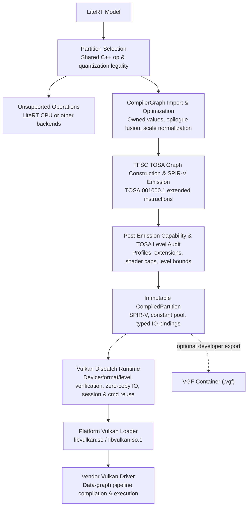

# Arm Vulkan ML Direct Compilation Architecture

The Arm Vulkan ML backend (`litert/vendors/arm_vulkan_ml/`) compiles and executes supported LiteRT graph partitions through the public [`VK_ARM_tensors`][vulkan-tensors], [`VK_ARM_data_graph`][vulkan-graphs], and [`VK_ARM_data_graph_instruction_set_tosa`][vulkan-tosa] Vulkan extensions.

LiteRT lowers supported operations directly to [`TOSA.001000.1`][tosa-spirv] SPIR-V graphs using Arm's [`tosa-for-spirv-codegen`][tfsc] (TFSC) core library, then hands an immutable in-memory executable artifact directly to the Vulkan dispatch runtime. The production path requires no TensorFlow, LLVM/MLIR, StableHLO converter pipelines, TOSA Converter for TFLite (TCFT), Arm Model Converter, or runtime VGF serialization round trips.

---

## End-to-End Pipeline

### Module Layout

| Directory | Shared Library / Binary | Responsibility |
| --- | --- | --- |
| `common/` | Header-only (`arm_vulkan_ml_jit_executable.h`) | Compiler–dispatch ABI (`CompiledPartition`, `TensorDescriptor`, `ConstantTensor`, `TosaLevelRequirements`) |
| `compiler/` | `libLiteRtCompilerPlugin_ArmVulkanML.so` | Partition selection, semantic lowering, `CompilerGraph` IR optimizations, TFSC SPIR-V emission, capability extraction |
| `dispatch/` | `libLiteRtDispatch_ArmVulkanML.so` | Vulkan loader resolution, capability/format/level validation, external buffer import (`AHardwareBuffer` / `DMA-BUF`), pipeline/session management, command-buffer reuse |
| `tools/devtool/` | `litert_arm_vulkan_ml_tool` | Offline/on-device inspection, compilation, VGF export, capability queries, numerical validation, and intermediate tracing |
| `tools/tosa_capabilities/` | Offline Python & C++ reference tools | Versioned `TOSA.001000.1` specification database (`tosa_001000_1.json`), lowering coverage audit, and Vulkan VUID inventory |
| `tools/testing/` | Qualification & regression harnesses | Synthetic operator fixtures, accumulator oracles, and Arm ML Emulation Layer execution checks |

---

## Compiler Architecture (`compiler/`)

### Unified Partition Selection and Legality Analysis

LiteRT invokes the compiler plugin first to partition each subgraph and then to compile selected partitions. Both stages run the same C++ legality analysis (`AnalyzeOperation` and `op_registry`):

- **Static dense tensor contract**: Delegated partitions require fixed positive shapes. Logical rank-0 LiteRT scalars are represented as 1-element physical tensors (`logical_scalar = true`) while preserving rank-0 buffer validation at the LiteRT runtime boundary.
- **Exact type, layout, and quantization validation**: An opcode registration alone never delegates an operation. Analysis validates operand element types, static ranks, axis/padding/stride/dilation geometry, broadcast compatibility, constant-operand requirements, and accumulator/rescale overflow bounds before admitting an op into a partition.
- **Conservative fallback**: Operations with dynamic shapes, unsupported options, or unprovable integer accumulator ranges remain unselected so LiteRT schedules them on CPU or another accelerator instead of failing late during compilation.

### Supported Numeric and Quantization Regimes

Lowering translates LiteRT operator semantics into `TOSA.001000.1` instructions across three primary numeric regimes (quantized activations are per-tensor, while constant weights and biases support **symmetric per-channel** as well as per-tensor quantization):

1. **`INT8` activations with per-channel or per-tensor symmetric `INT8` weights (`PRO-INT`)**:
   - **Activations**: Signed `INT8` with per-tensor affine quantization (`scale`, `zero_point`).
   - **Per-channel & per-tensor weights/biases**: `CONV_2D` (axis 0), `DEPTHWISE_CONV_2D` (axis 3), `TRANSPOSE_CONV` (axis 0), `CONV_3D` (DHWIO axis 4), and `FULLY_CONNECTED` (axis 0) accept constant symmetric `INT8` weights (`zero_point == 0` per channel) and matching per-channel `INT32` biases (`bias_scale[c] = input_scale * weight_scale[c]`). Each output channel `c` gets an independent `DotProductRange` overflow proof and a channelwise `Scale32` entry emitted as a single TOSA `RESCALE` with `per_channel = true`.
   - **Rounding & LUTs**: Base-profile rounding composition (`SINGLE_ROUND` `RESCALE` and explicit integer arithmetic) reproduces LiteRT quantization semantics without requiring `EXT-DOUBLEROUND`. Nonlinear activations and cross-scale unary operations (`LOGISTIC`, `TANH`, `HARD_SWISH`, `ABS`, requantized `RELU`/`RELU6`) use compile-time 256-entry `INT8` `TABLE` lookups.
2. **`A16W8` / symmetric `INT16` activations with per-channel or per-tensor `INT8` weights (`PRO-INT` + `EXT-INT16`)**:
   - **Activations**: Zero-point-0 signed `INT16` per-tensor activations.
   - **Per-channel & per-tensor `A16W8` weights/biases**: `FULLY_CONNECTED` accepts symmetric per-channel (axis 0) or per-tensor `INT8` weights with matching `INT64` biases, `INT48` accumulation (`requires_shader_int64`), per-channel accumulator range checks, and channelwise 16-bit multiplier `RESCALE` (`per_channel = true`, decomposing large channel scales via left-shift amplification when needed).
   - **Activations, MatMul & Normalization**: `BATCH_MATMUL` uses `INT48` accumulation with 3D `RESCALE`; nonlinear activations (`GELU`, `TANH`, `LOGISTIC`, `RSQRT`, and two-LUT `CLZ`-normalized `SOFTMAX`) use 513-entry `INT16` `TABLE` slope-intercept lookups; composite normalizations (`LayerNorm`, `RMSNorm`, `L2Norm` via `STABLEHLO_COMPOSITE`) lower through `FP32` accumulation when `PRO-FP` is available alongside `EXT-INT16`.
3. **Floating-point and auxiliary integer/boolean subsets (`PRO-FP` / `PRO-INT`)**:
   - Static `FP32` arithmetic, convolutions (`CONV_2D`, `DEPTHWISE_CONV_2D`, `TRANSPOSE_CONV`, `CONV_3D`), pooling, reductions, `SOFTMAX`, `BATCH_MATMUL`, `GATHER`, `SCATTER_ND`, and resize ops.
   - `BOOL` graph interfaces use 8-bit integer storage (`TensorElement::kInt8`) with explicit `CAST` conversions at partition boundaries; `UINT32` shift operations map across the interface via 32-bit integer storage without arithmetic signedness conversion; `COMPLEX64` values use interleaved `FP32` storage with a trailing size-2 component dimension.

See [README.md](README.md) and [`implementation_coverage.json`](tools/tosa_capabilities/implementation_coverage.json) for per-operator constraints.

### `CompilerGraph` IR and Optimization Passes

Before emitting SPIR-V, `ImportGraph` (`compiler/graph_ir.h`) converts a selected LiteRT subgraph into an owned `CompilerGraph`:

- **Pointer-free ownership**: `GraphValue` copies shapes, quantization vectors, and constant payloads at import time. Model pointers are retained only as opaque identities so optimization and codegen never dereference borrowed LiteRT memory.
- **Ordered quantization epilogues**: `GraphNode` separates an operator's core computation (`OperationPlan`) from a sequence of `OutputTransform` stages (`kClamp`, `kTable`, `kRescale`). Consecutive `RESCALE` stages are never naively collapsed by multiplying scales, preserving exact intermediate rounding and saturation behavior.
- **Targeted graph rewrites (`OptimizeGraph`)**:
  - Folds activation clamps (`RELU`, `RELU6`, scalar `MINIMUM`/`MAXIMUM` bounds) into preceding quantized or floating-point producers.
  - Eliminates identity `RESHAPE` and identity `QUANTIZE` nodes and composes compatible single-use shape/epilogue chains.
  - Normalizes even `SINGLE_ROUND` `Scale32` multipliers and shifts when accumulator range proofs remain valid under the reduced shift.

### TFSC Graph Construction and SPIR-V Emission

`CompilePartition` (`compiler/partition.cc`) walks the optimized `CompilerGraph` and emits `TOSA.001000.1` instructions through TFSC (`tfsc::tosa::Graph`):

- **In-memory SPIR-V generation**: TFSC constructs the SPIR-V `OpGraphARM` module, type declarations, `OpGraphConstantARM` bindings, and extended instructions directly in memory without intermediate MLIR modules or temporary files.
- **Constant deduplication**: Identical constant tensors share entries in `GraphConstantPool`, reducing constant descriptor count and memory footprint.
- **Post-emission requirement extraction (`tosa_requirements.cc`)**: The compiler inspects the emitted SPIR-V module to populate `CompiledPartition` with exact required TOSA profiles (`PRO-INT`, `PRO-FP`), TOSA extensions (such as `EXT-INT16`), Vulkan shader capabilities (`shaderInt16`, `shaderInt64`), `GraphMetrics`, and `TosaLevelRequirements` (`max_rank`, `max_tensor_bytes`, `max_kernel`, `max_stride`, `max_scale`, `max_tensor_list_size`, `max_nesting`).

---

## Compiler–Dispatch Artifact Contract (`common/`)

The compiler and dispatch communicate exclusively through `CompiledPartition` (`common/arm_vulkan_ml_jit_executable.h`), wrapped in `ArmVulkanMLJitExecutable`:

- **Program payload**: 32-bit SPIR-V words (`spirv`), entry-point name, instruction-set name (`TOSA.001000.1`), required profiles/extensions, Vulkan shader feature flags, and `TosaLevelRequirements`.
- **Resource descriptors**: Ordered `inputs`, `outputs`, and `constants`, each carrying a `TensorDescriptor` (`TensorElement`, physical `shape`, descriptor `binding`, original `LiteRtElementType`, and `logical_scalar` flag).
- **Lifetime isolation**: `CompiledPartition` is published as `std::shared_ptr<const CompiledPartition>` and contains no LiteRT model pointers, TFSC objects, or Vulkan handles. Each `VulkanInvocation` retains shared ownership of `CompiledPartition` for its entire lifetime, so destroying the `LiteRtModel` or compiler plugin never invalidates constants or metadata used by active invocations.

### Role of VGF

Vulkan Graph Format (`.vgf`) is **not** used on the production compile-and-dispatch path. Passing `CompiledPartition` in memory avoids container serialization and decoding overhead during JIT compilation. Offline VGF packaging remains available in `litert_arm_vulkan_ml_tool compile --dump_vgf` for standalone inspection and external driver tooling.

---

## Dispatch and Vulkan Execution (`dispatch/`)

### Public Vulkan Extension Boundary

Dispatch dynamically opens `libvulkan.so` on Android and `libvulkan.so.1` on Linux, resolving instance and device entry points through `vkGetInstanceProcAddr` and `vkGetDeviceProcAddr`. No private vendor driver interface or bundled driver binary is used.

- **Extension revisions**: The backend builds against pinned `Vulkan-Headers` (1.4.349+) and requires `VK_ARM_tensors` `specVersion >= 2` (`VK_ARM_TENSORS_SPEC_VERSION >= 2`), `VK_ARM_data_graph`, and `VK_ARM_data_graph_instruction_set_tosa`, alongside `synchronization2`, `vulkanMemoryModel`, and `maintenance5`.
- **Fixed-shape pipeline contract**: In accordance with Vulkan's `OpGraphARM` runtime SPIR-V rules ([VUIDs 09919–09923][vulkan-graph-shapes]), graph interface tensors and graph constants carry explicit static shapes matching the `VkTensorDescriptionARM` resources supplied at pipeline creation.

### Multi-Stage Device and Capability Verification

Before creating pipelines or allocating tensors, `VulkanInvocation` verifies compatibility across three layers (`device_capabilities.cc`, `tensor_capabilities.cc`):

1. **Device & feature checks**: Confirms required Vulkan extensions, `VkPhysicalDeviceTensorFeaturesARM`, `VkPhysicalDeviceDataGraphFeaturesARM`, and any required `shaderInt16` / `shaderInt64` features.
2. **Engine profile, extension & TOSA level checks**: Queries `vkGetPhysicalDeviceQueueFamilyDataGraphEngineOperationPropertiesARM` (`VkQueueFamilyDataGraphTOSAPropertiesARM`) to select a queue family and processing engine advertising every profile and extension required by `CompiledPartition`, and checks `TosaLevelRequirements` against the engine's advertised `VkDataGraphTOSALevelARM` bounds. Unadvertised extensions are always rejected. On commercially available MediaTek Dimensity 9600 retail phones with `Arm Mali-G2-Ultra-NX`, for example, `PRO-INT` and `EXT-INT16` are advertised as `ACCELERATED | CONFORMANT`, `PRO-FP` is advertised as `CONFORMANT`-only (shader fallback), and `EXT-DOUBLEROUND` is unadvertised—confirming the design choice to rely solely on base-profile `SINGLE_ROUND` `RESCALE`.
3. **Tensor limit & format checks**: Queries `VkPhysicalDeviceTensorPropertiesARM` (verifying `maxTensorDimensionCount`, per-dimension bounds, element/byte limits, and descriptor counts) and `VkTensorFormatPropertiesARM` via `vkGetPhysicalDeviceFormatProperties2` (requiring linear-tiling `VK_FORMAT_FEATURE_2_TENSOR_DATA_GRAPH_BIT_ARM` for every input, output, and constant format). Checking physical tensor limits independently of `VkDataGraphTOSALevelARM` is essential on shipping silicon: retail Dimensity 9600 / `Mali-G2-Ultra-NX` devices advertise `VK_DATA_GRAPH_TOSA_LEVEL_8K_ARM` (abstract rank ceiling 6) while reporting `maxTensorDimensionCount = 4` on `VkPhysicalDeviceTensorPropertiesARM`.

### Pipeline Session, Scratch Memory, and Command-Buffer Reuse

During `VulkanInvocation::Build`:

1. Dispatch creates the `VkShaderModule`, IO `VkTensorARM` / `VkTensorViewARM` descriptors, descriptor set layout, pipeline layout, and `VkDataGraphPipelineARM` (`vkCreateDataGraphPipelinesARM`), supplying `ConstantTensor` payloads via `VkDataGraphPipelineConstantARM`.
2. Dispatch creates a `VkDataGraphPipelineSessionARM`, queries `vkGetDataGraphPipelineSessionBindPointRequirementsARM` and `vkGetDataGraphPipelineSessionMemoryRequirementsARM`, allocates device memory via `DeviceMemoryAllocator`, and binds session scratch memory via `vkBindDataGraphPipelineSessionMemoryARM`.
3. On execution, `VulkanInvocation` records `VkTensorMemoryBarrierARM` barriers (`VkTensorDependencyInfoARM` chained to `VkDependencyInfo`), descriptor bindings, and `vkCmdDispatchDataGraphARM` into a reusable `VkCommandBuffer`. Subsequent runs resubmit the cached command buffer without re-recording unless an IO tensor attachment changes. Execution is synchronized per invocation via `VkFence`.

### Zero-Copy External Buffers

`dispatch_api.cc` and `external_buffer.cc` negotiate per-slot buffer requirements with LiteRT's `TensorBuffer` runtime:

- **Preference order**: Android prefers `AHardwareBuffer` (`AHARDWAREBUFFER_FORMAT_BLOB` with `GPU_DATA_BUFFER`), then `DMA-BUF`, then `HostMemory`; Linux prefers `DMA-BUF`, then `HostMemory`.
- **Import validation**: External buffer types are advertised only when the selected device exposes the corresponding external-memory Vulkan extensions and `vkGetPhysicalDeviceExternalTensorPropertiesARM` reports the exact linear tensor description as importable. Attachment validates allocation size, memory-type bits, offset alignment, and aliasing rules before binding the imported memory directly to `VkTensorARM` without CPU mapping or per-inference staging copies.
- **Synchronization**: Producer sync events (`buffer_events.h`) are waited prior to execution, and external/foreign queue-family tensor ownership is acquired before `vkCmdDispatchDataGraphARM` and released afterward. Slots backed by `HostMemory` use mapped staging buffers with explicit tensor barriers.

---

## Dependency Boundaries

Keeping the compiler and dispatch plugins lightweight and independent of full ML converter toolchains is a core design invariant:

| Component | Production Compiler / Dispatch | Developer & Test Tooling Only | Not Used |
| --- | --- | --- | --- |
| LiteRT plugin & model C/C++ APIs | Yes | Yes | — |
| `tosa-for-spirv-codegen` (TFSC) core + `SPIRV-Headers` | Compiler plugin | Yes | — |
| `Vulkan-Headers` (pinned 1.4.349+) + platform `libvulkan` | Dispatch runtime | Yes | — |
| `SPIRV-Tools` & `ml_sdk_vgf_library` | — | `litert_arm_vulkan_ml_tool` (`--dump_vgf`, SPIR-V validation) | — |
| Arm ML Emulation Layer + Mesa Lavapipe | — | Host execution tests (`LITERT_ARM_VULKAN_ML_ALLOW_EMULATION=1`) | — |
| `tosa_001000_1.json` & Python audit scripts | — | Offline specification queries & coverage/VUID audits | — |
| TensorFlow, LLVM/MLIR, StableHLO converters, TCFT, Arm Model Converter | — | — | Excluded from backend |

---

## Specification Reference, Diagnostics, and Qualification

Normative TOSA specification rules, implemented compiler subsets, host emulation results, and native hardware qualification are tracked as distinct layers:

- **Offline specification database ([`tools/tosa_capabilities/`](tools/tosa_capabilities/README.md))**: Deterministic Python extractors build `tosa_001000_1.json` (66 `TOSA.001000.1` opcodes and 350 type combinations) from pinned Khronos `SPIRV-Registry` (`3b5c31fdd42ed166ef174bd7f1b3613672b6cc46`) and Arm `tosa-specification` (`v1.0.1`) snapshots, alongside `vuid_audit.py` and `audit_lowering.py`. Neither the JSON database nor Python scripts are used at inference runtime.
- **Developer CLI ([`tools/devtool/`](tools/devtool/README.md))**: `litert_arm_vulkan_ml_tool` runs on Linux and Android to inspect partition coverage (`inspect`, `coverage`), compile partitions and optionally export `.vgf` files (`compile`), query device/tensor capabilities (`capabilities`) or offline TOSA rows (`tosa-query`), and compare/trace partition outputs against CPU references (`validate`, `trace`).
- **Emulation and device testing ([`tools/testing/`](tools/testing/README.md))**: Unit tests (`compiler/*_test`, `dispatch/vulkan_invocation_test`, `tools:devtool_test`) verify lowering legality, SPIR-V validity, VUID boundary behavior, and fake-driver dispatch lifecycles; host emulation tests execute the production compiler and dispatch plugins over [Arm's ML Emulation Layer for Vulkan][arm-emulation] on Mesa Lavapipe. Because software emulation does not capture retail hardware properties—such as `maxTensorDimensionCount = 4`, `ACCELERATED | CONFORMANT` (`PRO-INT`, `EXT-INT16`) vs. `CONFORMANT`-only (`PRO-FP`) quality flags, or zero-copy `AHardwareBuffer`/`DMA-BUF` tensor importability observed on commercially available MediaTek Dimensity 9600 (`Mali-G2-Ultra-NX`) retail devices—on-device validation remains a separate qualification step.

[tfsc]: https://github.com/arm/tosa-for-spirv-codegen/blob/6b15b5828f5df3a2ae5a4b2a345982a8b8073f14/README.md
[tosa-spirv]: https://github.khronos.org/SPIRV-Registry/extended/TOSA.001000.1.html
[vulkan-graph-shapes]: https://docs.vulkan.org/spec/latest/appendices/spirvenv.html#VUID-RuntimeSpirv-pNext-09919
[vulkan-tensors]: https://docs.vulkan.org/refpages/latest/refpages/source/VK_ARM_tensors.html
[vulkan-graphs]: https://docs.vulkan.org/refpages/latest/refpages/source/VK_ARM_data_graph.html
[vulkan-tosa]: https://docs.vulkan.org/refpages/latest/refpages/source/VK_ARM_data_graph_instruction_set_tosa.html
[arm-emulation]: https://github.com/arm/ai-ml-emulation-layer-for-vulkan
