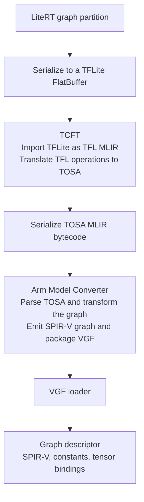
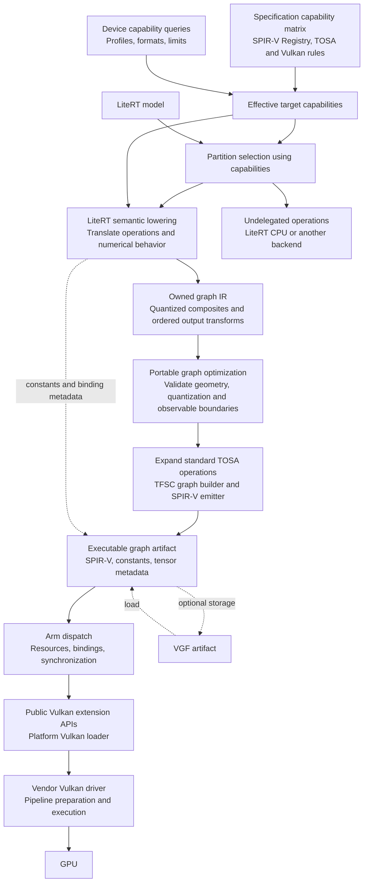
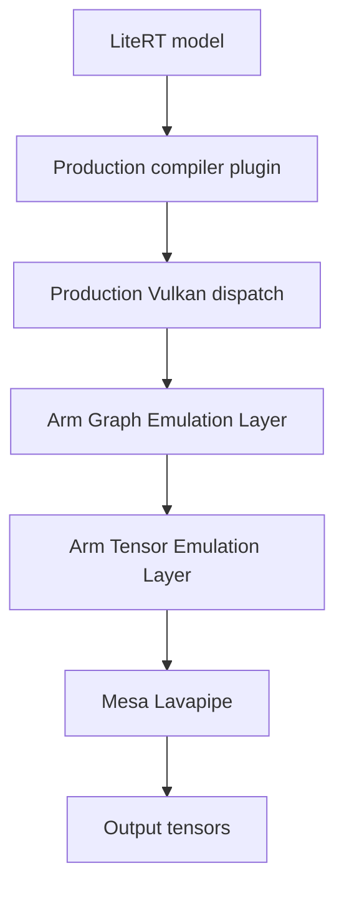

# Arm Vulkan ML direct compilation architecture

**Status:** Architecture with a fixed-shape JIT implementation; emulator qualification and numerical limits are tracked in the regression and developer-tool documentation

**Updated:** October 28, 2026

**Comparison baseline:** [LiteRT PR 10660][pr], revision [14b1c3309][pr-revision]

**Development baseline:** `upstream/main` at `df9d9f057fa7a279a334d5a91c84e47856f45752`,
branch `arm-vulkan-direct-preflight`.

The proposed architecture combines LiteRT semantic lowering with Arm's
[`tosa-for-spirv-codegen` core library][tfsc], abbreviated TFSC, to produce SPIR-V
graphs containing TOSA instructions. LiteRT translates supported model operations;
TFSC constructs and encodes the target graph. This preserves LiteRT's compiler
plugin and dispatch boundaries while removing the general model conversion stack
from the Arm backend's device build.

TOSA remains the definition of the operations submitted to the driver. A separate
TOSA MLIR representation, TensorFlow, TCFT, and Arm Model Converter are not
architectural requirements for producing those instructions. VGF remains useful
for storing and exchanging compiled graphs, but the compiler and runtime can
exchange an executable graph in memory without a VGF serialization round trip.
Dispatch uses public Vulkan extension APIs through the platform loader. The
vendor's Vulkan driver owns device-specific compilation and execution.

## Current architectural realization

The compiler and dispatch exchange an owned in-memory artifact containing SPIR-V,
constant bytes, typed tensor bindings and required profiles. No VGF round trip
is needed. Each invocation owns its Vulkan objects and retains that artifact;
model destruction cannot invalidate executable constants. The platform Vulkan
loader and vendor driver implement device interaction.

The implemented model path uses signed int8 activations/weights and int32
accumulation, with a limited FP32 prefix for MobileNetV3 Large. The latter needs
both PRO-INT and PRO-FP. Accumulator requantization uses native TOSA RESCALE
with SINGLE_ROUND to preserve driver fusion opportunities. It accepts local
rounding differences from LiteRT's double-rounding reference instead of
expanding them into tensor arithmetic. The architecture does not depend on
EXT-DOUBLEROUND being available. Grouped
convolutions can be expressed through channel slices, ordinary convolutions and
concatenation without another conversion framework.

The structured capability matrix remains development data, extracted from
`/data/bt/os/SPIRV-Registry` and the pinned TOSA specification. Runtime legality
checks and device profile queries are compiled code, not a JSON database lookup.
Normative TOSA capability rows must remain distinct from implementation coverage
and measured device support. [Implementation scope](README.md) and
[regression testing](tools/testing/README.md) track those separately.

Small image checks establish execution and numerical agreement only. They do
not establish ImageNet accuracy, native driver conformance or performance.

## Background

LiteRT separates model execution from vendor compilation. A compiler plugin
selects supported graph regions and produces a representation that its dispatch
implementation can execute. The Arm Vulkan ML integration targets devices with
the required Vulkan tensor and data graph capabilities. An Arm CPU alone does not
establish support for this execution path.

LiteRT's September 30, 2026 [TensorFlow dependency removal][tf-removal] changed
the default OSS build to use shim repositories rather than fetch TensorFlow.
The full TensorFlow dependency remained available for converter targets and tests
through `--config=with_tensorflow`. This separated the ordinary runtime build
from the larger model conversion toolchain.

[PR 10660][pr] connects the Arm compiler plugin to that optional toolchain. It
adds TOSA Converter for TFLite, abbreviated TCFT, and Arm Model Converter to
compile partitions on the device. Its [Android build configuration][pr-ci]
enables `--config=with_tensorflow`. This expands the Arm backend's dependencies;
it does not make TensorFlow a requirement of every LiteRT backend.

The general TFLite converter already depends on TensorFlow utilities,
LLVM/MLIR, and StableHLO/VHLO. The PR reuses that converter, so these dependencies
become reachable from the Arm compiler. **A dependency graph is not a sequence of
model conversions:** StableHLO is present through the importer and its libraries,
not a required intermediate stage between ordinary TFLite operations and TOSA.
The PR's TCFT wrapper disables the importer's VHLO-to-StableHLO conversion, but
the [importer target][flatbuffer-import] still includes those dependencies.

TFSC is distinct from TCFT. TFSC provides graph construction and SPIR-V encoding;
TCFT translates TFLite models through MLIR. Before the PR, the Arm integration
already [declared TFSC v2.0.0][pre-pr-deps] and included it as a
[placeholder compiler dependency][pre-pr-compiler]. The PR removes that repository
declaration while introducing TCFT and Model Converter. Reusing TFSC makes the
existing graph builder part of a defined compiler architecture; the earlier
placeholder did not supply LiteRT semantic lowering.

## Existing compilation architecture

The PR constructs the following pipeline for each delegated partition:

The [conversion wrapper][pr-conversion] serializes a graph that LiteRT already
holds in memory, then passes it through two compiler libraries. The intermediate
TOSA bytecode and VGF are also held in memory; this is not a pipeline of temporary
files or external compiler processes. The [JIT wrapper][pr-jit] decodes the VGF
into a graph descriptor used by the plugin's compiled-result handle.

These boundaries allow the integration to reuse established converters and their
operator handling. They also require serialization, parsing, separate compiler
contexts, and a larger dependency closure. Combining the libraries could reduce
some boundary overhead, but would not by itself remove their TensorFlow or MLIR
dependencies.

The baseline [dispatch implementation][pr-dispatch] does not yet execute models.
The diagram therefore ends at the graph descriptor. The proposed compiler and
execution architecture below describes the intended complete system.

## TOSA semantics and compiler representation

TOSA, the Tensor Operator Set Architecture, defines tensor operations and their
numerical behavior. MLIR is one compiler framework that can represent and
transform those operations. These are separate architectural choices.

For the execution path under discussion, the output graph uses the
[`TOSA.001000.1` SPIR-V extended instruction set][tosa-spirv]. Each TOSA operator
maps to an extended instruction. The
[`VK_ARM_data_graph_instruction_set_tosa` extension][vulkan-tosa] describes
support for this instruction set and queries for supported profiles and
extensions. The driver consumes this graph representation; it does not require
the application to construct a TOSA MLIR module first.

The broader SPIR-V graph mechanism can accommodate other operation sets.
Retaining TOSA here is a choice to preserve the Arm execution path used by this
integration, not a claim that all Vulkan computation requires TOSA.

| Layer | Architectural role | Decision |
| --- | --- | --- |
| LiteRT graph | Defines the model partition and its original semantics | Retain as the compiler input |
| TOSA operation semantics | Defines the operations understood by the selected graph execution path | Retain |
| TOSA MLIR module and bytecode | Intermediate representation used by the existing converters | Eliminate from the proposed direct path |
| TFSC graph builder | Constructs TOSA instructions and their SPIR-V representation | Reuse the core library |
| SPIR-V graph | Encodes the program submitted through Vulkan | Retain |
| VGF | Packages graphs, constants, and metadata | Make optional at the compiler/runtime boundary |
| Vulkan data graph pipeline | Provides device-specific preparation and execution | Retain |

Khronos's [tensor and data graph sample][vulkan-sample] creates a Vulkan pipeline
from a SPIR-V module and separately supplies tensor resource information. This
interface permits a direct emitter. It does not require TCFT, Model Converter,
MLIR, or VGF as the producer of that module.

## Proposed architecture

The compiler consumes LiteRT's existing graph representation and resolves
supported operations into TOSA semantics. It uses TFSC to construct the graph
and emit its SPIR-V binary, then combines that binary with constants and tensor
metadata into an executable artifact shared with dispatch. No TOSA MLIR module
or serialized TOSA interchange format is needed between these components.

### Portable optimization boundary

The compiler keeps graph values, quantization, constants and original-operator
provenance in an owned IR before allocating SPIR-V result IDs. Quantized
convolution, depthwise/transpose convolution, binary arithmetic, fully connected,
pooling and lookup functions are recognizable composites. Their ordered
output transforms retain intermediate rounding, zero points and saturation;
two rounded scales are not combined by multiplication. All composites expand
to standard TOSA instructions at emission. Device packing, physical aliasing,
scheduling and hardware fusion remain the driver's responsibility.

Portable rewrites can simplify shape chains and constant layouts, absorb
spatial real-zero padding into a legal convolution, compose compatible clamps
and INT8 lookups, and share immutable constants. Graph inputs/outputs,
persistent values and additional consumers constrain removal and fusion.
Partition legality uses the same operation analysis as before optimization;
emitted graph requirements are recomputed for device acceptance.

`off`, `exact` and `qualified` modes support differential validation. Exact
rewrites preserve integer results. Approximate rules require both exhaustive
local INT8 error checks and bounded end-to-end model differences before being
enabled in qualified mode. A locally bounded affine requantization candidate
failed that second gate and remains disabled; local error bounds alone do not
establish model-level accuracy. The capability database stays a development
aid, not a runtime dependency. This architecture adds no Regor dependency,
custom VGF operation or dispatch ABI.

### LiteRT integration and capability selection

LiteRT continues to own the model, partition orchestration, and execution across
backends. The Arm plugin reads graph information through LiteRT's compiler
interfaces. Graph inspection should follow the existing
[compiler context boundary][runtime-context], avoiding a requirement to serialize
and reload the model through the runtime library.

Partition selection requires a complete path from LiteRT semantics through TFSC
to the device: the lowering understands the operation, its tensor and numerical
configuration is supported, TFSC can encode the resulting graph, and the target
advertises the required capabilities. An opcode alone is insufficient.
Unsupported regions remain with LiteRT for execution elsewhere. This decision
belongs at partition selection, rather than relying on a late compilation
failure to discover unsupported semantics.

### Capability matrix and specification sources

The compiler's support contract is a versioned capability matrix containing
**operator × type combination × shape/layout constraints × required
profile/extension**. Partition selection and lowering use the same contract.
Each entry describes a legal target configuration; LiteRT lowering coverage,
TFSC encoding coverage, and device support determine whether that configuration
is available for delegation.

| Matrix field | Information represented |
| --- | --- |
| Operation | TOSA operator and SPIR-V instruction-set version |
| Type combination | Exact types for every input and output, including weights, bias, zero points, and accumulation where applicable |
| Shape and layout constraints | Operand ranks, dimension relationships, logical axis order, broadcasting, and requirements for known shapes |
| Required profile or extension | Enabling profiles/extensions, preserving alternative and combined requirements, plus applicable TOSA level bounds |
| Attributes and numerical constraints | Constant-argument requirements, allowed attribute values, quantization, rounding, and precision conditions |
| Source | Specification revision, file, and operator section or validity rule supporting the entry |

The specification layer of the matrix is now stored in the versioned
[`tosa_001000_1.json`](tools/tosa_capabilities/tosa_001000_1.json) database, with
**66 mapped operators and 350 type combinations**. Its primary source is the
local **`/data/bt/os/SPIRV-Registry`** checkout, specifically
[`extended/TOSA.001000.1.html`][local-tosa-spirv], especially the per-operator
argument descriptions and **Type support** tables. The source snapshot for this
design is registry revision
[`3b5c31fdd42ed166ef174bd7f1b3613672b6cc46`][registry-snapshot]. Matrix metadata
records the source revision and instruction-set version so that specification
updates are explicit. The local checkout supplies specification data; its
absolute path is not a requirement for building or running LiteRT.

The database uses a checked JSON schema and deterministic extraction from pinned
Git objects. TOSA 1.0.1's XML, operator prose and pseudocode supplement the
registry with logical shapes, rank and level constraints, base-profile
requirements, precision rules and 155 indexed validation expressions. That
supplement is pinned to commit `7010bd19cb1e5468f5a60f578b961fc476bd6ae3`
(tag `v1.0.1`), available in the local TFSC dependency checkout. Extraction does
not switch or modify either source repository. The [database reference](tools/tosa_capabilities/README.md)
describes the data contract, provenance, queries and reproducibility checks.

The JSON database is a development and validation input, not a runtime
dependency. The compiler and dispatch do not load it. Compiler legality checks
implement the supported constraints; compiled artifacts record their required
instruction set, profiles, and extensions, which dispatch checks against Vulkan
device queries. Any future generated compiler tables are produced before
runtime and do not require shipping the database or its Python tooling.

This initial database records specification facts. Its query tool filters exact
type rows and profile/extension requirements; it does not evaluate every shape,
attribute or numerical rule. Context-dependent assertions and normative prose
remain explicitly marked as unevaluated. Constraint evaluation, LiteRT lowering,
TFSC coverage and device support are separate fields. Unknown or unresolved
conditions cannot become an affirmative delegation decision. This keeps a
reference row distinct from an implemented, device-supported configuration.

The registry defines the SPIR-V representation and refers to the
[TOSA specification][tosa-spec] for full operator semantics. Those definitions
supplement the extracted tables with shape equations, broadcasting, numerical
rules, and level limits. The registry's `SPV_ARM_tensors` and `SPV_ARM_graph`
documents describe tensor and graph encoding; [Vulkan's SPIR-V environment
rules][vulkan-graph-shapes] add API-specific validity constraints. Each constraint
retains its source. Requirements expressed in prose or pseudocode must be
represented explicitly; extracting type tables alone does not establish complete
operator support. General TOSA features absent from the selected SPIR-V mapping
are outside the target contract.

The following entries illustrate the matrix's granularity. They summarize
specification rules, not measured device support or implemented LiteRT coverage;
the complete matrix retains all operand and attribute conditions.

| Operator | Type combination | Shape/layout constraints | Required profile/extension |
| --- | --- | --- | --- |
| [ADD][registry-add] | FP16 inputs and output | Equal input ranks; TOSA broadcasting rules | `PRO-FP` |
| [ADD][registry-add] | BF16 inputs and output | Equal input ranks; TOSA broadcasting rules | `EXT-BF16` on `PRO-FP` |
| [CONV2D][registry-conv2d] | INT8 input/weights; INT32 bias, accumulator, and output | Rank-4 input `[N,IH,IW,IC]`, weights `[OC,KH,KW,IC]`; rank-1 bias; constant padding, stride, dilation, and zero points | `PRO-INT` |
| [MATMUL][registry-matmul] | INT8 inputs; INT32 output | Rank-3 `[N,H,C] × [N,C,W] → [N,H,W]`; constant zero points | `PRO-INT` |

Logical axis order is distinct from Vulkan tensor storage format, tiling, and
strides. Resource compatibility must satisfy both the operator's logical shape
rules and the device's tensor storage requirements.

The effective device matrix intersects specification rules with the capabilities
reported for the selected queue family, processing engine, and instruction set.
The [TOSA capability query][tosa-capability-query] reports profiles, extensions,
and a level through `VkQueueFamilyDataGraphTOSAPropertiesARM` when
`VK_ARM_data_graph_instruction_set_tosa` is available. Its
[quality flags][tosa-quality] describe acceleration, conformance, experimental
status, and deprecation. These remain separate from whether a configuration is
legal. Tensor [size and rank limits][tensor-limits] and
[format/tiling support][tensor-formats] further constrain the matrix. Device
support must be established by the driver contract; a registry entry or a TFSC
constructor alone does not establish hardware support.

For each LiteRT operation or decomposition, every resulting target operation must
satisfy the effective matrix, and LiteRT must preserve the source semantics.
Unknown or unsupported configurations remain undelegated. The executable artifact
records the capabilities it requires so dispatch can check compatibility again,
including for artifacts produced on another machine.

The shape contract is **fixed shapes per compiled graph pipeline**. Vulkan
requires explicit shapes for graph interface types and tensor constants, with
matching resource descriptions at pipeline creation
([VUIDs 09919–09923][vulkan-graph-shapes]). A shape resolved before compilation can
produce a specialized artifact. Changing that shape requires another compatible
artifact/pipeline or fallback; arbitrary shape changes on one compiled pipeline
are outside this design. This restriction belongs to the selected data-graph
API contract and does not describe every workload the GPU can execute.

### Semantic lowering owned by LiteRT

LiteRT owns the conversion from its model semantics to the target operation set.
It handles necessary decompositions, normalization, shape interpretation, and
constant transformations before expressing the result through TFSC. A compact
internal graph representation may still be useful for these transformations;
it does not require a general compiler framework or a serialized TOSA format.

Together, LiteRT lowering and TFSC replace the relevant work of TCFT and Model
Converter. LiteRT remains responsible for the semantic transformations and
optimizations needed by its supported workloads, as well as graph interfaces and
constant bindings. TFSC does not automatically reproduce the existing converters'
operator coverage or transformation pipelines.

### Graph construction and emission with TFSC

TFSC's [graph API][tfsc-graph] provides tensors, inputs, outputs, constants, and
TOSA operators. Its core library manages SPIR-V construction and
[binary emission][tfsc-emission], including instruction identifiers and module
structure. The selected design reuses that emitter within the compiler plugin.
TFSC does not execute the graph or call a GPU driver.

Graph construction is an in-memory API boundary. It introduces neither a general
model importer nor a separate TOSA MLIR stage. TFSC's construction checks help
identify malformed graphs, while LiteRT remains responsible for equivalence to
the source operations and compatibility with the selected device.

### Executable graph artifact

The compiler/runtime boundary carries a complete executable description:

- A SPIR-V graph module, entry point, and required instruction-set capabilities.
- Input and output bindings, tensor shapes, element types, and layout requirements.
- Constant bindings and storage with an explicit ownership and lifetime contract.

The artifact contains program and resource information, without compiler IR
objects or device handles. Dispatch can therefore consume it regardless of
whether compilation happened in the application or on a host machine.

TFSC supplies the SPIR-V representation, including references to external graph
constants. LiteRT supplies the corresponding constant bytes and resource metadata
and keeps their bindings consistent with the generated module. A SPIR-V binary
alone is not the complete executable artifact.

The scope is one executable graph per delegated partition, with shapes fixed for
that artifact and types and operations admitted by the capability matrix. A
workload requiring
multiple graph segments or custom compute shaders needs an execution-plan
representation beyond this boundary. The direct path does not implicitly inherit
all workloads supported by Model Converter.

### Dispatch and device execution

Dispatch owns Vulkan resource creation, tensor binding, graph pipeline and session
management, synchronization, and submission. It interprets the executable
artifact, checks compatibility with the device, and keeps graph resources and
constant storage alive for their required lifetime. Device-specific compilation,
hardware scheduling, and execution remain with the Vulkan driver.

The API boundary uses [`VK_ARM_tensors`][vulkan-tensors],
[`VK_ARM_data_graph`][vulkan-graphs], and
[`VK_ARM_data_graph_instruction_set_tosa`][vulkan-tosa], with their required
features and dependencies. These are public Arm vendor extensions in the Vulkan
registry, marked not ratified as of this document's update. They are not
universally supported core Vulkan ML APIs; the target must provide the specific
graph and operation capabilities needed by the artifact.

On Android, calls pass through the platform's `libvulkan.so` loader to the vendor
Vulkan driver. Vulkan is the public API contract implemented by that driver, and
the loader routes calls to it. LiteRT needs no private Mali driver interface or
bundled GPU driver. [Android's Vulkan architecture][android-vulkan] separates
these platform and vendor responsibilities.

## Dependency boundaries

The architectural objective is to make the Arm backend buildable without the
optional general converter stack. This changes the backend's dependency closure;
LiteRT's standalone converter can continue to use its existing dependencies.

| Component | Relationship to the PR | Role in the proposed direct path |
| --- | --- | --- |
| LiteRT model and plugin interfaces | Already part of LiteRT | Retained |
| TFLite schema and FlatBuffers | Already part of LiteRT model handling | Retained where model loading needs them; no partition serialization round trip |
| TCFT | New backend dependency in the PR | Replaced by direct semantic translation |
| General TFLite converter | Existing tooling newly reached from this backend | Not required by the direct translator |
| TensorFlow, StableHLO/VHLO, XLA/TSL converter support | Existing converter dependencies reached transitively | No dependency through the proposed backend compiler |
| LLVM/MLIR compiler libraries | Used by TCFT and Model Converter | Not required by LiteRT lowering or TFSC core |
| Arm Model Converter | New backend dependency in the PR | Necessary transformations move into LiteRT lowering; graph emission uses TFSC |
| TFSC core library | Declared before the PR; repository declaration removed by the PR | Reused for graph construction and binary emission |
| TOSA and SPIR-V definitions | Target instruction contract | Retained as specification and encoding knowledge |
| SPIRV-Registry documentation | Source for the capability matrix | Used to derive versioned compiler metadata; no runtime documentation parser or registry checkout dependency |
| SPIRV-Headers | Direct Arm dependency before the PR | Build-time definitions used by TFSC; no separate runtime library |
| VGF library | Already Arm-specific before the PR | Optional serialization and interoperability adapter |
| Vulkan headers | Existing backend dependency | Required API declarations at build time |
| Platform Vulkan loader and compatible driver | Device execution provider | Required at runtime |

TFSC's [core library][tfsc-build] uses the C++ standard library and SPIRV-Headers;
it does not require TensorFlow, StableHLO, MLIR, or LLVM compiler libraries.
The proposal selects this core rather than TFSC's complete tool suite. Optional
parsers, generators, VGF support, and comparison tools bring their own dependencies,
including TOSA serialization, FlatBuffers, and SPIRV-Tools. Several are enabled
by the project's default build, so the core and tooling dependency boundaries
must remain distinct.

[SPIRV-Tools][spirv-tools] and Vulkan validation layers can support development
without becoming mandatory shipped libraries. Arm's [ML emulation layer][arm-emulation]
is another optional development environment. Native device execution needs a
compatible Vulkan driver, while LiteRT's ordinary runtime dependencies remain.

LLVM/MLIR here refers to libraries embedded in the model compiler. This decision
does not constrain the C++ compiler used to build LiteRT, such as Clang from the
Android NDK.

The converter libraries would no longer be shipped merely to compile Arm graph
partitions. LiteRT lowering that calls back into the general importer or existing
TensorFlow-dependent lowering libraries would fail to achieve this dependency
boundary, even if TFSC performs final emission.

## VGF and deployment choices

VGF, Vulkan Graph Format, is a container for SPIR-V modules, constants, and
associated metadata. The [VGF library][vgf-library] encodes and decodes that
container. The container itself does not perform device execution.

For JIT compilation, the compiler can hand an owned executable artifact directly
to dispatch. Encoding it as VGF and immediately decoding it is optional. For
model distribution, persistent caching, and interoperability with Arm tooling,
VGF remains a useful representation. Keeping it as an adapter allows those uses
without making serialization part of every compilation. TFSC provides an optional
[VGF writer][tfsc-vgf] that can serve this packaging role without changing the
core graph construction path.

The same architecture supports two deployment arrangements:

| Arrangement | Model translation | Device responsibilities |
| --- | --- | --- |
| JIT | LiteRT lowering and TFSC core run alongside LiteRT | Translation, compatibility checks, Vulkan pipeline preparation, and execution |
| AOT | A host runs lowering and graph emission for a declared capability profile | Artifact loading, compatibility checks, Vulkan pipeline preparation, and execution |

Host translation does not eliminate device-specific Vulkan pipeline preparation.
It moves conversion from framework operations to a graph off the device. Arm's
[SDK production workflow][arm-workflow] already separates offline graph generation
from runtime consumption, although the LiteRT PR under discussion accepts only
the JIT flow.

A stored graph artifact is valid only for its model constants, shapes, numerical
configuration, format version, and required target capabilities. A cached Vulkan
pipeline is a different object with additional device and driver compatibility
constraints. These two forms of caching should remain distinct.

## Numerical behavior and supported coverage

The main architectural cost is ownership of semantic translation. LiteRT and
TOSA operations are not universally interchangeable. TFSC encodes the graph it
is given; LiteRT lowering must account for:

- Quantization scales, zero points, accumulator behavior, rescaling, and rounding.
- Broadcasting, tensor layout, convolution padding, and shape interpretation.
- Fused activations and operations that require decomposition into several target
  operations.
- Floating-point precision and special-value behavior within the chosen
  numerical contract.

The proposed boundary admits only configurations whose semantics can be
represented. Dynamic shapes, control flow, sparse tensors, and custom operations
remain outside the stated static tensor-graph scope unless the architecture is
extended explicitly. Conservative partitioning preserves execution through other
LiteRT backends when a configuration is unsupported.

Hardware optimizations performed by the driver do not substitute for correct
frontend translation. A driver cannot recover an incorrect quantization rule or
a lost activation from the submitted graph.

Quantized Softmax illustrates the distinction between storage and arithmetic
precision. Both selectable LUT layouts retain the same Q31 exponential values;
four INT8 tables or three INT16 tables reconstruct those values for INT32
normalization. INT16 tables therefore do not inherently improve accuracy.
The compiler proves signed accumulation and numerator bounds for its admitted
row lengths. `auto` chooses the base integer-profile path; forcing INT16 adds
`EXT-INT16` to the artifact requirements, which dispatch checks before pipeline
creation. Selection is a compilation option, not a per-inference switch.
Qualification uses an independent FP64 mathematical oracle and the XNNPACK QU8
operator with signed/unsigned rebasing. Legacy TFLite output differences are
recorded separately. Neither the compiler nor dispatch depends on gemmlowp or
XNNPACK for this lowering; XNNPACK is a developer-tool reference dependency.

## Software emulation and execution testing

Host correctness tests use Arm's [ML Emulation Layer for Vulkan][arm-emulation]
with Mesa Lavapipe. The layer implements the public graph and tensor interfaces
on a software Vulkan device. LiteRT's compiler and dispatch submit the same
in-memory artifacts used by the production execution path.

The [test guide](tools/testing/README.md) documents synthetic operator checks,
real LiteRT model lifecycle tests, and a convolution fixture exposing the
accumulator to an independent INT64 oracle. Full-model smoke comparisons use
three images per model through the shared evaluator. Expected values do not
reuse the compiler's arithmetic helpers.

VGF export remains an optional developer diagnostic. Emulator correctness tests
use direct dispatch and require neither Scenario Runner nor a Python VGF package.
Generated artifacts, inputs and execution reports stay in ignored output folders.
Emulator results do not establish native GPU performance, universal operator/type
support or Vulkan conformance. The device capability checks and native execution
qualification remain necessary; see Arm's [emulation limitations][arm-emulation-limitations].

## Architectural tradeoffs

The direct path removes general converter dependencies and the associated
representation boundaries while retaining TFSC as a focused third-party library.
Reusing its graph builder and emitter reduces the amount of compiler code LiteRT
owns. The strongest benefit is control over the backend's build and deployment
footprint. Compilation latency, memory use, and execution performance still
depend on the lowering, generated graph, and driver.

LiteRT remains responsible for operator coverage and numerical fidelity. TFSC
provides a reusable encoding implementation, and its supported instruction-set
versions must agree with the lowering and device capability contract. Reusing a
general converter provides substantial value when broad model coverage is more
important than minimizing the compiler stack.

| Architecture | Benefit | Cost or limitation |
| --- | --- | --- |
| LiteRT semantic lowering with TFSC core | Removes general converter libraries and intermediate serialization while reusing graph construction and emission | LiteRT owns semantic lowering and coverage; TFSC remains a focused dependency |
| LiteRT lowering with a custom SPIR-V emitter | Gives LiteRT ownership of the full compiler | Duplicates graph construction and encoding responsibilities already provided by TFSC |
| Dedicated LiteRT-to-TOSA frontend with an MLIR backend | Removes the general importer while retaining compiler transformations | Keeps MLIR and backend compiler dependencies; reused lowerings may still depend on TensorFlow |
| Unified TCFT and Model Converter library | Can share compiler state and avoid the TOSA bytecode boundary | Does not inherently remove the general converter dependency closure |
| Host compilation with the existing Arm tools | Keeps established conversion behavior and removes those compilers from the device package | Retains the host stack and requires precompiled artifacts for supported model configurations |

The selected architecture pairs a bounded LiteRT lowering contract with TFSC's
reusable emitter. A host conversion path can provide wider frontend coverage
through the same artifact/dispatch boundary, provided its output satisfies the
executable graph contract.

[pr]: https://github.com/google-ai-edge/LiteRT/pull/10660
[pr-revision]: https://github.com/google-ai-edge/LiteRT/commit/14b1c33094987c0ac5cfc5a07c5f0563e94b6438
[tf-removal]: https://github.com/google-ai-edge/LiteRT/commit/d4086147067c2c9834257ce8c12cacd43515209a
[pr-ci]: https://github.com/google-ai-edge/LiteRT/blob/14b1c33094987c0ac5cfc5a07c5f0563e94b6438/.github/workflows/linux_android.yml#L107
[flatbuffer-import]: https://github.com/google-ai-edge/LiteRT/blob/14b1c33094987c0ac5cfc5a07c5f0563e94b6438/tflite/converter/BUILD#L1875
[pr-conversion]: https://github.com/google-ai-edge/LiteRT/blob/14b1c33094987c0ac5cfc5a07c5f0563e94b6438/litert/vendors/arm_vulkan_ml/compiler/tcft_model_converter.cc#L186
[pr-jit]: https://github.com/google-ai-edge/LiteRT/blob/14b1c33094987c0ac5cfc5a07c5f0563e94b6438/litert/vendors/arm_vulkan_ml/compiler/jit/jit_compiler.cc#L28
[pr-dispatch]: https://github.com/google-ai-edge/LiteRT/blob/14b1c33094987c0ac5cfc5a07c5f0563e94b6438/litert/vendors/arm_vulkan_ml/dispatch/dispatch_api.cc
[pre-pr-deps]: https://github.com/google-ai-edge/LiteRT/blob/236d3a7a626ad12f34648a3cf1f82055debb36ad/third_party/arm_vulkan_ml/workspace.bzl
[pre-pr-compiler]: https://github.com/google-ai-edge/LiteRT/blob/236d3a7a626ad12f34648a3cf1f82055debb36ad/litert/vendors/arm_vulkan_ml/compiler/BUILD
[tfsc]: https://github.com/arm/tosa-for-spirv-codegen/blob/6b15b5828f5df3a2ae5a4b2a345982a8b8073f14/README.md
[tfsc-graph]: https://github.com/arm/tosa-for-spirv-codegen/blob/6b15b5828f5df3a2ae5a4b2a345982a8b8073f14/include/tosa/Graph.hpp
[tfsc-emission]: https://github.com/arm/tosa-for-spirv-codegen/blob/6b15b5828f5df3a2ae5a4b2a345982a8b8073f14/include/TosaForSpirvCodegen.hpp
[tfsc-build]: https://github.com/arm/tosa-for-spirv-codegen/blob/6b15b5828f5df3a2ae5a4b2a345982a8b8073f14/CMakeLists.txt
[tfsc-vgf]: https://github.com/arm/tosa-for-spirv-codegen/blob/6b15b5828f5df3a2ae5a4b2a345982a8b8073f14/tools/vgfwriter/src/VgfWriter.cpp
[runtime-context]: ../../../docs/apis/runtime_context.md
[tosa-spirv]: https://github.khronos.org/SPIRV-Registry/extended/TOSA.001000.1.html
[local-tosa-spirv]: /data/bt/os/SPIRV-Registry/extended/TOSA.001000.1.html
[registry-snapshot]: https://github.com/KhronosGroup/SPIRV-Registry/tree/3b5c31fdd42ed166ef174bd7f1b3613672b6cc46
[registry-add]: https://github.khronos.org/SPIRV-Registry/extended/TOSA.001000.1.html#_add
[registry-conv2d]: https://github.khronos.org/SPIRV-Registry/extended/TOSA.001000.1.html#_conv2d
[registry-matmul]: https://github.khronos.org/SPIRV-Registry/extended/TOSA.001000.1.html#_matmul
[tosa-spec]: https://www.mlplatform.org/tosa/tosa_spec_1_0_1.html
[vulkan-graph-shapes]: https://docs.vulkan.org/spec/latest/appendices/spirvenv.html#VUID-RuntimeSpirv-pNext-09919
[tosa-capability-query]: https://docs.vulkan.org/refpages/latest/refpages/source/vkGetPhysicalDeviceQueueFamilyDataGraphEngineOperationPropertiesARM.html
[tosa-quality]: https://docs.vulkan.org/refpages/latest/refpages/source/VkDataGraphTOSAQualityFlagBitsARM.html
[tensor-limits]: https://docs.vulkan.org/refpages/latest/refpages/source/VkPhysicalDeviceTensorPropertiesARM.html
[tensor-formats]: https://docs.vulkan.org/refpages/latest/refpages/source/VkTensorFormatPropertiesARM.html
[vulkan-tensors]: https://docs.vulkan.org/refpages/latest/refpages/source/VK_ARM_tensors.html
[vulkan-graphs]: https://docs.vulkan.org/refpages/latest/refpages/source/VK_ARM_data_graph.html
[vulkan-tosa]: https://docs.vulkan.org/refpages/latest/refpages/source/VK_ARM_data_graph_instruction_set_tosa.html
[vulkan-sample]: https://docs.vulkan.org/samples/latest/samples/extensions/tensor_and_data_graph/simple_tensor_and_data_graph/README.html
[android-vulkan]: https://source.android.com/docs/core/graphics/arch-vulkan
[spirv-tools]: https://github.com/KhronosGroup/SPIRV-Tools
[vgf-library]: https://arm.github.io/ai-ml-sdk-for-vulkan/vgf-lib/docs/in/index.html
[arm-workflow]: https://arm.github.io/ai-ml-sdk-for-vulkan/introduction.html
[arm-emulation]: https://github.com/arm/ai-ml-emulation-layer-for-vulkan
[arm-prebuilt]: https://arm.github.io/ai-ml-sdk-for-vulkan/installing.html
[arm-emulation-wheel]: https://pypi.org/project/ai-ml-emulation-layer-for-vulkan/0.11.0/#files
[arm-sdk-compatibility]: https://arm.github.io/ai-ml-sdk-for-vulkan/compatibility.html
[mesa-driver-selection]: https://docs.mesa3d.org/install.html
[arm-vgf-run]: https://arm.github.io/ai-ml-sdk-for-vulkan/vgf_run_tutorial.html
[arm-emulation-limitations]: https://arm.github.io/ai-ml-sdk-for-vulkan/emulation-layer/docs/in/limitations.html
