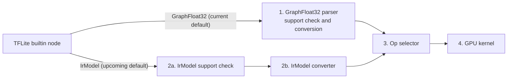

# Adding a Builtin GPU Operator

LiteRT's GPU accelerator covers fewer TFLite builtin operators than the CPU
runtime. When a model uses a builtin operator the GPU does not support, that
node falls back to the CPU, which splits the graph and adds CPU/GPU
synchronization overhead.

This guide explains how to add a GPU implementation for such an operator, using
ScatterND as the running example. All changes stay inside this directory:

-   The LiteRT runtime needs no changes, because builtin operators are already
    known to the op resolver.
-   The upstream ML Drift repository needs no changes, because the delegate has
    its own hooks for adding kernels.

## How a builtin operator reaches the GPU

The delegate has two graph pipelines. GraphFloat32 is the default today, and
IrModel will replace it. Each pipeline decides for itself whether it accepts a
node, and each has its own code for converting the node into ML Drift's graph.
After conversion, both hand the node to an op selector, which picks the GPU
kernel.



Implement both step 1 and step 2, so that your operator works now and keeps
working after the switch.

## Files to add or change

Paths are relative to this directory. Cumsum is a good builtin operator to copy
from for steps 1 and 2, and the GLU kernel for steps 3 and 4.

| Step                     | Files                                    | Example to copy                    |
| :----------------------- | :--------------------------------------- | :--------------------------------- |
| 1. GraphFloat32 pipeline | `tflite/model_builder.cc`                | `CumsumOperationParser`            |
| 2a. IrModel support check | `tflite/support/support_<op>.{h,cc}`, `tflite/support/support.cc` | `tflite/support/support_cumsum.cc` |
| 2b. IrModel converter    | `tflite/convert/convert_<op>.{h,cc}`, `tflite/ir_model_builder.cc` | `tflite/convert/convert_cumsum.cc` |
| 3. Op selector           | `delegate/composite/litert_op_selector.cc`, `delegate/composite/ir/litert_op_selector.cc` | `CreateGluFromNode`, `CreateGluFromIrOp` |
| 4. GPU kernel            | `delegate/extension/<op>_kernel.{h,cc}`, `delegate/extension/BUILD` | `delegate/composite/glu_kernel.cc` |
| Tests                    | `tflite/support/support_<op>_test.cc`, `tflite/convert/convert_<op>_test.cc` | `support_cumsum_test.cc`, `convert_cumsum_test.cc` |

Each new source file needs a library target in the `BUILD` file next to it, and
the target that uses it must list the new target as a dependency.

New kernels go in `delegate/extension/`, which keeps them apart from the
StableHLO composite operators in `delegate/composite/`. Add a library target
for your kernel to `delegate/extension/BUILD`, and add that target to the
dependencies of both op selectors.

## Step 1: GraphFloat32 pipeline (current default)

In this pipeline one parser class does both jobs. `IsSupported` decides whether
the delegate takes a node, and `Parse` turns the node into a node in ML Drift's
graph. A node that `IsSupported` rejects stays on the CPU, so it is safe to
start narrow and widen later.

Add the class in `tflite/model_builder.cc` and return it from
`NewOperationParser` for your builtin code:

```cpp
class ScatterNdOperationParser : public TFLiteOperationParser {
 public:
  absl::Status IsSupported(const TfLiteContext* context,
                           const TfLiteNode* tflite_node,
                           const TfLiteRegistration* registration) final {
    return ValidateSupport(context, tflite_node, registration,
                           {.max_version = 1,
                            .min_inputs = 3,
                            .max_inputs = 3,
                            .num_outputs = 1,
                            .check_gpu_compatibility = false});
  }

  void Parse(const TfLiteNode* tflite_node,
             const TfLiteRegistration* registration,
             ::ml_drift::GraphFloat32* graph, ObjectReader* reader) final {
    ::ml_drift::Node* node = graph->NewNode();
    node->operation.type = "scatter_nd";
    reader->AddInput(node, 0);  // indices
    reader->AddInput(node, 1);  // updates
    reader->AddOutputs(node);
  }
};
```

The node name is what the op selector matches on in step 3, so use the same
name in both pipelines. If the kernel needs values that are fixed at conversion
time, store them in the node's attributes here.

Two things are easy to miss:

-   **Turn off the GPU compatibility check.** By default `ValidateSupport` also
    consults TFLite's own list of GPU-compatible operators. An operator you are
    adding is not on that list, so the node is rejected with "Not supported op".
-   **Allow int32 inputs if you have them.** An operator with an int32 input
    that is not a constant must be added to the operators allowed to take int32
    inputs, in `GetOpsToReplaceWithOptions` in the same file. Otherwise the node
    is rejected with "Tensor type(INT32) is not supported". ScatterND needs this
    for its indices.

## Step 2: IrModel pipeline (upcoming default)

In this pipeline the support check and the conversion are separate functions.

### 2a. Support check

Add a function that accepts only the configurations your kernel handles. It
usually covers the operator version, the number of inputs and outputs, the
tensor data types, and which inputs must be constant. The helpers in
`tflite/support/support_aux.h` cover each of these.

Register the function in `IsNodeSupported` in `tflite/support/support.cc`:

```cpp
auto scatter_nd = absl::bind_front(IsScatterNdSupported, context, node,
                                   registration, error);
// In the switch on registration->builtin_code:
case kTfLiteBuiltinScatterNd: return scatter_nd();
```

If both pipelines accept the same configurations, call this function from the
parser's `IsSupported` in step 1 as well. The rules then live in one place.

### 2b. Converter

Add a converter function in `tflite/convert/convert_<op>.cc`:

```cpp
void ConvertScatterNd(
    const TfLiteContext& context, const TfLiteNode& node,
    const TfLiteRegistration& registration,
    absl::flat_hash_map<int, ::ml_drift::ir::IrTensorId>& tensor_map,
    ::ml_drift::ir::IrModel& ir_model) {
  ::ml_drift::ir::IrOp* op = ir_model.add_op();
  op->name = "scatter_nd";

  ir_model.AddConsumer(tensor_map.at(node.inputs->data[0]), op->id);
  ir_model.AddConsumer(tensor_map.at(node.inputs->data[1]), op->id);
  ir_model.SetProducer(tensor_map.at(node.outputs->data[0]), op->id);
}
```

Call it from `AddNode` in `tflite/ir_model_builder.cc`:

```cpp
auto scatter_nd =
    absl::bind_front(ConvertScatterNd, context_, node, registration,
                     std::ref(tensor_map), std::ref(ir_model));
// In the switch on registration.builtin_code:
case kTfLiteBuiltinScatterNd: return scatter_nd();
```

## Step 3: Op selector

The op selector maps a graph node to a GPU kernel. There is one selector per
pipeline, and both fall back to ML Drift's built-in kernels for names they do
not recognize. Add a branch for your node name ahead of that fallback.

```cpp
// delegate/composite/litert_op_selector.cc
if (node.operation.type == "scatter_nd") {
  return CreateScatterNdFromNode(inputs, outputs, node, model_builder);
}

// delegate/composite/ir/litert_op_selector.cc
if (op.name == "scatter_nd") {
  return CreateScatterNdFromIrOp(inputs, outputs, op, model_builder);
}
```

The two functions differ only in how they read the attributes and tensor ids.
Have both call one shared function that builds the kernel, as the GLU kernel
does.

## Step 4: GPU kernel

The kernel is a subclass of ML Drift's `GPUOperation` whose shader is written
in UCL, ML Drift's shader language. One UCL source compiles for OpenCL, WebGPU,
Metal, and Vulkan, so you write the kernel once.

Writing the shader itself is covered by the
[ML Drift guide to adding a kernel](https://github.com/google-ai-edge/ml-drift/blob/main/docs/skills/add-new-kernel/SKILL.md).
Once you have the operation, add it to the model builder. The shape of the
output is available from the output tensor that the op selector passes in.

```cpp
ABSL_ASSIGN_OR_RETURN(auto indices, model_builder->GetTensor(indices_id));
ABSL_ASSIGN_OR_RETURN(auto updates, model_builder->GetTensor(updates_id));

::ml_drift::TensorDescriptor dst_desc = updates.tensor_desc;
dst_desc.SetBHWCShape(output_shape);
auto dst = model_builder->AddTensor(dst_desc);

auto op = CreateScatterNdOp(indices.tensor_desc, updates.tensor_desc,
                            dst.tensor_desc);
model_builder->AddGpuOperation({indices, updates}, {dst}, std::move(op),
                               "scatter_nd");
return model_builder->UpdateOutputTensor(dst, output_id);
```

## Testing

Add a unit test for the IrModel support check and one for the IrModel
converter, following the Cumsum tests. They need no GPU.

Then add a test that runs the operator on a real GPU. Build a small model that
contains only your operator, create a compiled model with only the GPU
accelerator selected, and compare the output with values computed on the CPU in
the test. With only the GPU selected, creating the model fails if the delegate
does not take your node, and the log says why.

Run that test in both FP32 and FP16 precision, and for both pipelines. The
option that selects the pipeline is not public. A test reaches it by defining
the `litert::test::GpuOptionsTestPeer` class, which `GpuOptions` declares as a
friend.
